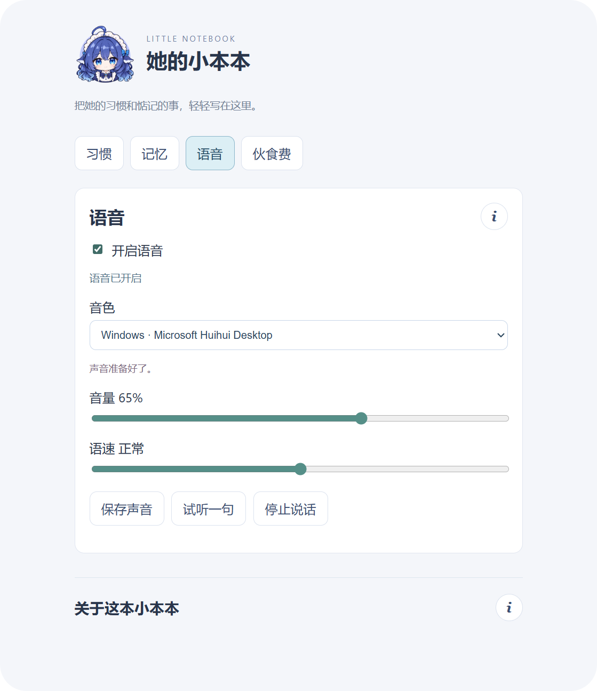
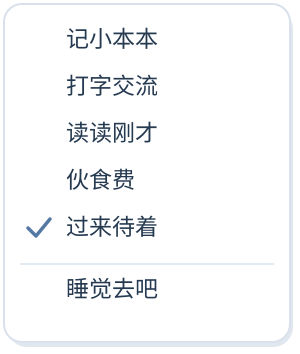
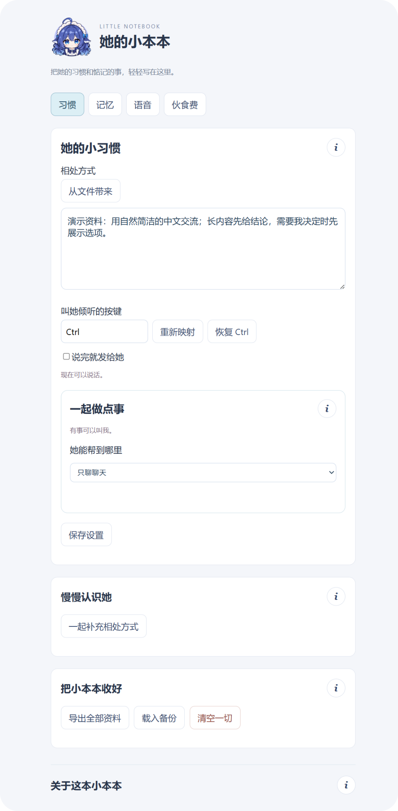
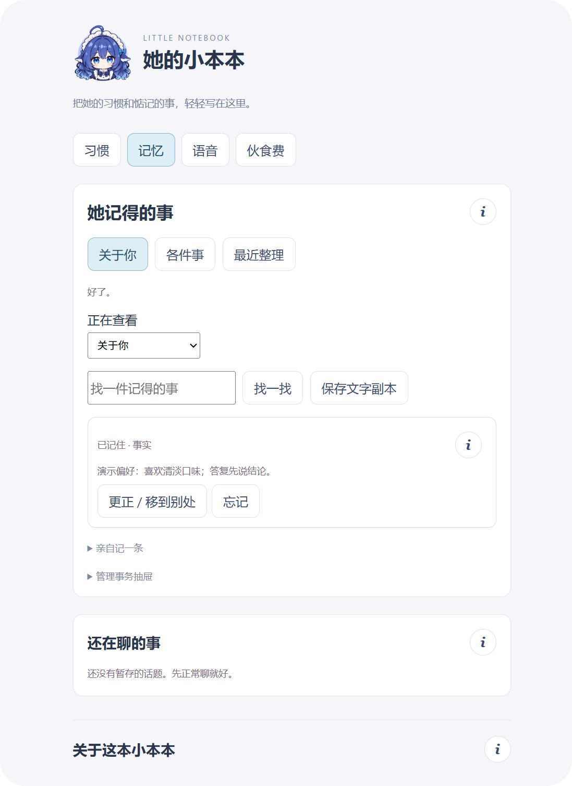
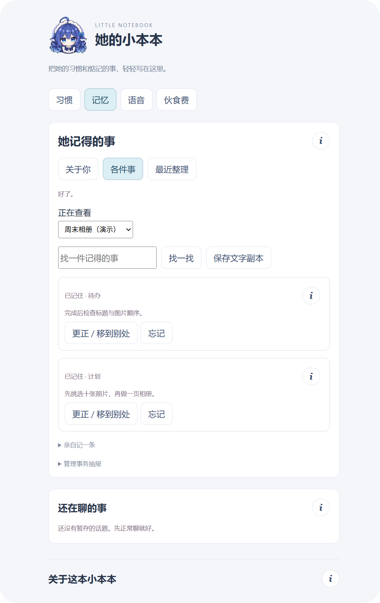
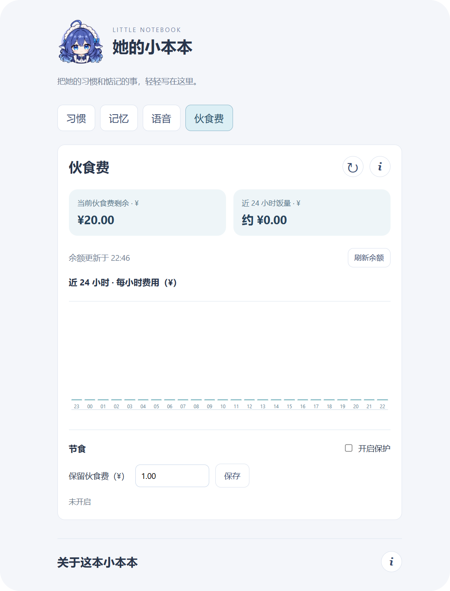
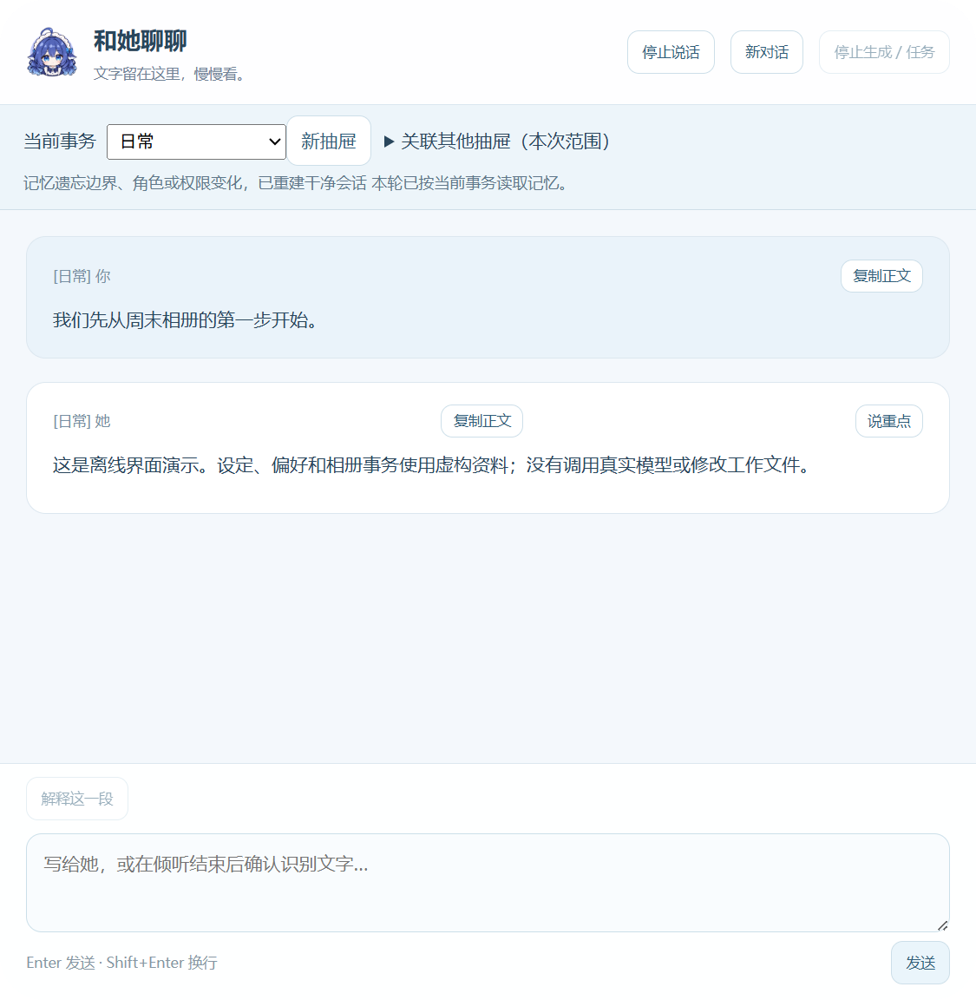

<a id="top"></a>


# Cute-Partner · 可爱的助手

[](#sec61)
[](#sec32)
[](#sec54)
[](#sec12)
[](#sec22)

[🇨🇳 中文](README.md) | [🇺🇸 English](README_EN.md)

**Cute-Partner 是一个陪你交流、一起干活的桌面伙伴。**

她把模型与工具能力放在身后：你可以直接与她交谈，向她交付任务，在需要决定时回答她的问题，也可以只让她陪在桌面上。

项目当前以 DeepSeek Harness 为后台运行框架，默认搭载的角色是大肥鱼——**哦鲸鲸**：

<p align="center">
  
</p>

<p align="center"><em>图 1 – 与鼠标互动的哦鲸鲸</em></p>

> 在使用项目前，建议按顺序阅读：① [项目概览](#sec1) → ② [项目部署](#sec3) → ③ [运行与使用](#sec4)。  
> 如果需要进一步开发，请阅读 [开发与扩展](#sec5)。

---

## 目录

- [1. 项目概览](#sec1)
  - [1.1. 项目定位](#sec11)
  - [1.2. 系统组成](#sec12)
  - [1.3. 使用场景](#sec13)
- [2. 功能实现](#sec2)
  - [2.1. 桌面角色](#sec21)
  - [2.2. 设定与记忆](#sec22)
  - [2.3. 处理事务](#sec23)
  - [2.4. 结构化对接](#sec24)
  - [2.5. 资料管理](#sec25)
  - [2.6. 伙食费与用量](#sec26)
  - [2.7. 语音功能](#sec27)
- [3. 项目部署](#sec3)
  - [3.1. 项目结构](#sec31)
  - [3.2. 前置工作](#sec32)
  - [3.3. 基础安装](#sec33)
  - [3.4. 语音组件安装](#sec34)
- [4. 运行与使用](#sec4)
  - [4.1. 首次交流](#sec41)
  - [4.2. 角色界面](#sec42)
  - [4.3. 小本本指南](#sec43)
  - [4.4. 阅读与回答](#sec44)
  - [4.5. 导出、载入与重置](#sec45)
- [5. 开发与扩展](#sec5)
  - [5.1. 宿主与界面接口](#sec51)
  - [5.2. 模型、工具与问题接口](#sec52)
  - [5.3. 设定、记忆与资料接口](#sec53)
  - [5.4. 角色显示与动作接口](#sec54)
  - [5.5. 语音识别与合成接口](#sec55)
  - [5.6. 配置与 Harness 集成接口](#sec56)
- [6. 项目信息](#sec6)
  - [6.1. 系统版本](#sec61)
  - [6.2. 测试环境](#sec62)
  - [6.3. 后续规划](#sec63)
  - [6.4. 使用与授权说明](#sec64)

---

<a id="sec1"></a>

## 1. 项目概览 [⌃](#top)

图形化的智能体工具让人与模型协作变得更直观。Cute-Partner 希望在这种交互方式上加入角色的形象、声音与持续记忆，让交流和工作协作融入桌面陪伴。

你可以与她聊日常、告诉她自己的偏好，也可以向她交付工作、回答问题并查看结果。希望她逐渐成为一个熟悉你的、仿佛有“灵魂”的桌面伙伴，是这个项目的出发点。

---

<a id="sec11"></a>

### 1.1. 项目定位 [⌃](#top)

Cute-Partner 同时面向日常陪伴与工作协作。角色端承接用户能看见、能操作的交流体验；模型端负责理解需求、生成回复，并通过工具参与任务处理。

```text
Cute-Partner · 可爱的助手
      │
      ├── 角色端：与你交流，呈现进展与结果
      │     ├── 桌面陪伴：Live2D 形象、自然动态、视线与动作反馈
      │     ├── 信息交流：文字输入、白云消息、完整阅读与可选声音
      │     ├── 共同决定：展示问题、选项、修改差异和权限审批
      │     └── 资料查看：设定、记忆、事务、修订与用量入口
      │
      └── 模型端：理解需求，组织回复与任务
            ├── 日常交流：结合设定与本轮相关记忆生成回复
            ├── 信息整理：提出设定修改、整理偏好与事务记录
            ├── 工作协作：规划步骤、提出问题，并调用已接入工具
            └── 结果反馈：将回复、问题与工具进展交回角色界面
```

两端由桌面应用连接：资料保存、权限校验、工具执行协调和停止控制由程序负责。模型提出的修改与任务结果，会按相应规则经过确认、保存或核验，再反馈到界面。

---

<a id="sec12"></a>

### 1.2. 系统组成 [⌃](#top)

项目由**角色交互层、桌面应用层、后台运行层**组成。它们分别负责交流入口、本机服务协调，以及模型会话与工具运行。

```text
┌──────────────────────────────────────────────────────────┐
│                       角色交互层                          
│                                                                           
│      文字或语音输入 → 阅读回复 → 回答问题 / 审批 / 停止         
└──────────────────────────┬───────────────────────────────┘
                           │ 受控 preload IPC
                           ▼
┌──────────────────────────────────────────────────────────┐
│                      桌面应用层
│                Cute-Partner（Electron）
│                                                          
│  会话管理 ── 问题与工具状态 ── 操作权限                   
│      ├── 设定 / SQLite 记忆 / 事务                  
│      ├── 本地识别 / 自然语音（可选项）                 
│      └── 角色事件 → Live2D 参数驱动         
└──────────────────────────┬───────────────────────────────┘
                           │ 独立后台会话
                           ▼
┌──────────────────────────────────────────────────────────┐
│                      后台运行层
│              DeepSeek Harness 与模型服务                   
│
│      模型回复  ·  工具调用  ·  结构化问题  ·  用量报告          
└──────────────────────────────────────────────────────────┘
```

系统的功能采用模块化设计，角色显示、记忆、事务与资料管理等基础功能由基础程序提供，而本地语音识别和自然语音模块资源则由用户需求决定是否进行装载。

当前已适配的后台运行框架为 DeepSeek Harness。Cute-Partner 管理自己的窗口、资料与用户交互，Harness 在后台提供独立会话与工具运行能力。程序首次运行需准备本机账户及运行依赖，而在加载完成后，日常与角色的交流中无需再切到 Harness 聊天界面逐条操控模型。

开发者可以沿现有源码中的模块边界扩展角色、语音、工具或模型适配，调用接口与源码入口见[5. 开发与扩展](#sec5)。

---

<a id="sec13"></a>

### 1.3. 使用场景 [⌃](#top)

她，可以陪你聊天，也可以在需要时一起处理工作。

<table>
<tr>
<th width="50%">日常陪伴</th>
<th width="50%">工作助手</th>
</tr>
<tr>
<td align="center" valign="top"></td>
<td align="center" valign="top"></td>
</tr>
<tr>
<td valign="top">
<p><strong>在日常的小事里，慢慢熟悉彼此。</strong></p>
<p>空闲时聊几句，告诉她自己的喜好，或一起讨论周末的安排。她可以结合已保存的设定与相关记忆回应你；回复消息留在云朵上，详尽内容则可以打开“和她聊聊”仔细阅读。</p>
<p>文字交流可直接使用；准备好本地语音组件后，也可以通过声音交流。</p>
</td>
<td valign="top">
<p><strong>把具体的工作交给她，一起推进。</strong></p>
<p>请她协助整理文件、编写内容或处理工作区任务。需要补充信息或审批时，在云朵上作决定；执行中可请求停止，并查看工具结果与实际文件。</p>
<p>持续目标可以整理成事务，保留计划、待办与后续决定，方便下次接着做。</p>
</td>
</tr>
</table>

<p align="center"><em>图 2, 3 – 角色的一瞬</em></p>

实际界面与操作见[2. 功能实现](#sec2)和[4. 运行与使用](#sec4)。

---

<a id="sec2"></a>

## 2. 功能实现 [⌃](#top)

Cute-Partner 将智能体的对话与工具能力接入角色界面，让交流、记忆和任务进展在桌面上连贯呈现。项目的各项功能进行模块化设计，文字交流、角色显示、记忆和资料管理模块共同组成基础体验，而自定义音色的语音模块则按用户的使用需求作为可选加载模块。

下面简要介绍角色怎样与你互动、怎样记住信息和协助工作、模型输出如何转换为界面内容的基础逻辑，最后介绍资料、用量与可选语音。

---

<a id="sec21"></a>

### 2.1. 桌面角色 [⌃](#top)


<table>
<tr>
<td width="55%" valign="top">
<p><strong>她会留意你的动作，也会回应当前发生的事。</strong></p>
<p>角色通过 Live2D 在桌面驻留。移动鼠标时，视线、头部与身体会在一定范围内跟随；点击、拖动以及交流、倾听和工作状态，也会产生相应反馈。没有操作时，呼吸、眨眼和自然摆动等微小动作将继续维持角色动态。</p>
<p>交流中，短消息将实时显示在随身云朵上，详细内容则留在“和她聊聊”板块中。你可以只让她陪着，也可以随时交付一项具体任务。</p>
<p><em>右图（图4）为真实原生模型录制。可见箭头标示输入位置；鼠标沿角色周围环绕。</em></p>
</td>
<td width="45%" align="center" valign="middle"></td>
</tr>
</table>

角色的动作、表情与云朵消息共同呈现交流进展，让倾听、思考和办事都有可感知的回应。

<a id="sec22"></a>

### 2.2. 设定与记忆 [⌃](#top)

**设定**描述角色的人物设定，你可以在其中完成对角色的性格、习惯等等人物背景描述，支持自定义文本写作或完整文档导入；
**记忆**记录“以后还会用到的信息”，在项目初次运行时完全空白，会随着你与角色的沟通逐渐累计记忆，也可以在后台导入记录。
两者在本机保存，交流时程序只挑选与当前范围相关的内容交给模型。模型可以提出修改或整理请求，再由程序按确认、来源与修订规则处理。

```text
交流中的信息
    ├── 相处方式、表达习惯  → 融合进设定
    ├── 明确要求记住的资料  → 先保存原话 → 按规则整理归属
    └── 模型整理出的资料  → 普通归类直接保存，冲突或重要修改先确认 → 后续交流按范围检索使用
```

#### 2.2.1. 相处方式与设定修订

<table>
<tr>
<td width="55%" align="center" valign="middle"></td>
<td width="45%" valign="top">
<p><strong>把交流中的小要求，变成可查看的相处方式。</strong></p>
<p>例如告诉她：“长内容先给结论，再展开说明。”你可以在小本本中手动填写，也可以在交流中让她提出设定修改。</p>
<p>她提出的修改会展示差异，确认后保存；在“习惯 → 慢慢认识她”中可以核对最新内容、修改来源及修订，必要时撤销。</p>
<p><em>左图（图5）为她更新自己做事习惯的例子，展示设定更新的口语反馈。</em></p>
</td>
</tr>
</table>

#### 2.2.2. 关于你的资料与偏好

**重要的信息可以留下来，之后也能更正。**

例如：“请记住：我喜欢清淡口味。”角色会先把明确要求记住的原话保存下来，再按规则整理。关于你的资料与偏好放在“关于你”模块中，与具体事项有关的内容会被她自动归入对应事务条目中。

条目保留来源和修订，方便检查记了什么、从哪里来。发现归属不合适或内容变化时，可以人为更正、移动或忘记。

记忆会随交流不断整理：普通归类自动完成，遇到信息冲突或重要修改时再请你确认；每条记录都保留来源与修订，方便日后调整。后续交流会围绕当前话题和事务检索相关记忆，让已经聊过的偏好、计划和决定自然接续下去。

<a id="sec23"></a>

### 2.3. 处理事务 [⌃](#top)

她能够将一段持续目标的资料衔接起来，视为一件**事务**，任务则是一次具体的执行，这套流程类似于针对特定主题建立一个单独的工作文件夹。你可以持续讨论同一件事，也可以在选定工作范围后，让她实际使用工具处理文件或内容。

#### 2.3.1. 事务：保存持续目标

**让计划、决定和待办围绕同一件事积累。**

例如：“周末整理照片，先挑选十张，再做一页相册。”相关内容可以整理成“事务抽屉”，继续保存后续决定和待办，方便下一次接着聊、接着做。

事务是资料的组织方式，创建抽屉不会额外授予文件权限。

#### 2.3.2. 任务：从交付到汇报

一次工作协作，从你说明目标开始。选好办事范围和工作目录后，把任务交给她；遇到信息缺口或需要你决定的操作，她会在交流中提出问题。随后由工具执行具体步骤，核对产出，再由角色汇报进展与结果。

```text
选择办事范围与工作目录 → 交付具体任务 → 补充信息 / 权限审批 → 工具执行 → 核对结果 → 角色汇报
```

例如，请她把工作目录中的资料整理成一份清单：先说明整理目标，回答必要的问题，随后查看生成的清单和她的总结。讨论中形成的新决定，也可以继续留在对应事务里，为下一次协作积累上下文。

<a id="sec24"></a>

### 2.4. 结构化对接 [⌃](#top)

同一轮交流可以包含一句口头回应、一份详细结果和几个待回答的问题。Cute-Partner 会把这些内容分配到对应的界面，让简短交流保持轻快，完整信息也有清晰的阅读位置。

```text
后台输出
    ├── 回复内容
    │      ├── 简短口语稿 → 云朵 → 可选声音播放 → 音频驱动口型
    │      └── 详细正文   → “和她聊聊”中的完整内容与历史
    ├── 结构化问题       → 单选 / 多选 / 其他 / 多题 → 提交答案
    ├── 权限审批         → 展示操作请求 → 用户决定 → 继续执行
    └── 工具事件         → 进展 / 结果 / 停止 → 界面与角色状态
```

#### 2.4.1. 口语稿与正文

回复中的口语稿与正文分别组织。例如，一句适合直接说出的回应放在 `<voice>` 中，详细清单、步骤或代码放在 `<body>` 中：

```xml
<voice>我先整理一份清单，需要你决定时会再问你。</voice>
<body>这里保留详细说明、清单、代码或结果，供完整阅读。</body>
```

界面把简短口语送入云朵；开启声音后，再交给所选语音引擎朗读。详细正文同步进入“和她聊聊”，适合仔细阅读、复制和回顾。文字展示与声音播放各有自己的节奏，角色口型则跟随实际音频变化。

#### 2.4.2. 问题、审批与工具结果

问题请求转换为可操作的选择控件，支持单选、多选、“其他”和多题。云朵与阅读窗口共享同一份草稿，文字和语音答案都能接入当前问题。

操作审批、工具进展和执行结果也通过各自的事件送回界面。这样，一项工作可以在“提出问题—作出决定—继续执行—收到汇报”之间自然衔接，你可以随时查看进度或请求停止。

<a id="sec25"></a>

### 2.5. 资料管理 [⌃](#top)

角色的相处方式与设置、记忆与事务、聊天与问题记录、用量统计，以及已经完成的自制音色，共同组成你的本机个人资料。它们可以完整导出为 `.cpbackup` 文件，也可以预览后重新载入，方便备份、恢复和迁移到兼容的程序实例。

```text
                   ┌── 导出 → .cpbackup 备份 → 留存 / 迁移
本机资料 ────────────── 载入 → 预览备份内容 → 确认后替换
                   └── 重置 → 保留恢复路径 → 重新开始
```

导出统一保存这套个人资料，载入则以备份完整替换当前资料。账户凭据、安装环境、下载资源包和工作项目文件分别管理，不放入个人资料包。

<a id="sec26"></a>

### 2.6. 伙食费与用量 [⌃](#top)

模型消耗的 token，在小本本里被称为角色吃掉的“米粒”；模型账户余额则是她的“伙食费”。打开“伙食费”页，就能把剩余预算、近一天的消耗和每小时变化放在一起查看，还可以切换金额与 token 两种统计视角。

| 信息 | 含义 |
| --- | --- |
| 伙食费剩余 | 通过 DeepSeek 官方 `GET https://api.deepseek.com/user/balance` 查询当前账户余额，直观看到还剩多少预算 |
| 近 24h 饭量 | 汇总本应用在最近24小时收到的用量记录；可查看 token 数量，也可切换为对应的费用估算 |
| 每小时费用 | 将最近24小时分为24根小时柱，观察各时段的消耗变化；切换到米粒统计后，同一张图展示每小时 token 用量 |
| 节食保护 | 设置希望保留的余额，程序会在发送前和任务运行中检查；触及下限时暂停模型调用，并在云朵中提醒你 |

用量来自 Harness 会话报告，费用按应用内价格配置估算。余额可手动刷新，小时柱可查看时段明细；实际结算金额以服务商账单为准。

<a id="sec27"></a>

### 2.7. 语音功能 [⌃](#top)

<table>
<tr>
<td width="52%" align="center" valign="middle"></td>
<td width="48%" valign="top">
<p><strong>让文字有声音，也让交流更随意。</strong></p>
<p>语音模块把麦克风输入、声音生成和角色口型接在一起：你可以用声音聊天、回答问题，也可以让她读出简短回应。</p>
<p>在小本本的“语音”页选择系统声音或预置/自制音色，调整音量、语速与表达风格，随时试听或停止。自然语音还提供“早点开口”，让音频边合成边播放。</p>
<p>语音按需准备，基础文字交流可以独立使用；想让角色开口时，再选择适合自己设备的声音方案。</p>
<p><em>左图（图6）为语音设置页面。</em></p>
</td>
</tr>
</table>

#### 2.7.1. 语音组件

| 组件 | 用途 |
| --- | --- |
| Windows 系统语音 | 直接使用本机已安装声音，快速朗读口语稿 |
| 本地语音识别 | 将麦克风输入转成聊天文字或问题答案 |
| CosyVoice3 自然语音 | 使用预置或自制音色，生成带有不同表达风格的声音 |

系统声音可以在小本本中直接选择；本地识别与自然语音按需准备。安装流程统一见[3.4. 语音组件安装](#sec34)，完成后就能在同一个“语音”页面选择声音、制作音色并试听。

#### 2.7.2. 文字转语音

同一份口语稿可以交给两条本机语音路线，最终汇入播放与角色表现：

```text
             ┌── Windows 系统语音 → 本机声音 / 语速 ─────────┐
口语稿 ───────                                              ────── 播放 / 停止 → 口型与角色表现
             └── CosyVoice3 → 预置或自制音色 / 表达风格 ─────┘
```

| 方案 | 效果 |
| --- | --- |
| Windows 系统语音 | 启动轻便、响应快、资源占用低，但音色和语调较固定，机械感更明显 |
| CosyVoice3 自然语音 | 可使用自制音色，语气更流畅，但需要额外模型、显存和生成时间 |

CosyVoice3 的“**早点开口**”在默认语速下采用分块生成与播放，让声音更早开始；调整语速后采用整句生成。分块衔接有时会带来停顿，可根据听感选择开启或关闭。

#### 2.7.3. 自制音色

CosyVoice3 可以从参考声音和对应文字中提取音色条件。制作完成后，项目保存参考音频与特征数据，后续选择该音色时直接复用，并可叠加自然、柔和、开心等表达风格。

```text
参考音频（3–30秒）+ 音频对应文本
    → 检查格式、时长与有效声音
    → 整理为标准参考音频，提取音色特征
    → 保存并加入音色列表 → 选择音色与风格 → 生成新台词并试听
```

清晰的录音与准确的对应文字有助于保留声音特点。原理和上游用法可参阅 [CosyVoice库](https://github.com/QwenAudio/CosyVoice)。

<table>
<tr>
<td width="55%" valign="middle">
<p><strong>以下是同一句台词，两条路线的不同表现：</strong></p>
<p>试听文本：<code>La la la, la la la.</code></p>
<p><strong>Windows 系统语音</strong><br>Microsoft Huihui Desktop<br><a href="docs/media/voice-lalala-windows.wav">试听 WAV</a></p>
<p><strong>CosyVoice3 自然语音</strong><br>内置音色 · 自然风格<br><a href="docs/media/voice-lalala-natural.wav">试听 WAV</a></p>
<p>两份声音均在本机生成。点击音频链接试听，右侧动图（图7）展示自然语音对应的口型表现。</p>
</td>
<td width="45%" align="center" valign="middle"></td>
</tr>
</table>

---

<a id="sec3"></a>

## 3. 项目部署 [⌃](#top)

Cute-Partner 以 DeepSeek Harness 提供后台智能体能力，再把交流和工作协作带到桌面角色中。部署分为三步：先安装并配置 Harness，再准备 Cute-Partner 的基础运行环境，最后按需加入语音组件。

```text
准备 Harness → 安装 Cute-Partner → 确保交流无阻 → 按需添加语音
```

如果希望 Agent 协助部署，可把项目目录交给具备本机终端权限的 Agent，并复制下面的指示。将目录替换为自己的实际位置即可：

```text
请帮我部署 Cute-Partner，项目目录为：<填写本机项目根目录>。

先阅读 README 第3章「项目部署」，检查 Windows、Node.js、pnpm、Harness
和默认角色资源，按第3.2节「前置工作」及第3.3节「基础安装」完成基础部署。
我授权安装基础程序所需的依赖；请保留现有设置和个人资料。

语音模块不在本次默认安装范围内。请先完成角色显示与文字交流。
如果我另外要求安装本地语音识别或 CosyVoice3，请阅读第3.4节「语音组件安装」，
确认我需要的组件后，再按该节安装，准备相应模型和环境。

运行 pnpm run doctor 检查基础文件，再执行 pnpm start 启动角色。
首次成功加载角色后，程序会自动在桌面创建“哦鲸鲸”图标。
引导我发送一句问候确认能收到回复；这一步使用我的 DeepSeek API 额度。
账户和 API key 由我在 Harness 本机设置中配置，不需要我把密钥发给你。
遇到问题请定位并修复，完成后说明运行结果和仍需我操作的步骤。
```

<a id="sec31"></a>

### 3.1. 项目结构 [⌃](#top)

主要运行模块与开发入口如下：

```text
Cute-Partner/
    │
    ├── apps/desktop/                # 桌面应用
    │   ├── main.cjs                 # 窗口、服务组装与生命周期
    │   ├── preload.cjs              # 界面调用宿主的接口
    │   ├── server.cjs               # 本机服务与角色资源读取
    │   ├── launch.ps1               # 桌面快捷方式的后台启动入口
    │   ├── package.json             # 桌面依赖与脚本
    │   ├── pnpm-lock.yaml           # 固定依赖版本
    │   ├── pnpm-workspace.yaml      # 桌面依赖安装配置
    │   ├── model-service.config.json # 模型与调用限额
    │   ├── lib/                     # 对话、记忆、工具、语音与资料
    │   ├── ui/                      # 角色、白云、聊聊与小本本
    │   ├── assets/                  # 图标与预置音色
    │   ├── optional-modules/        # 可选语音组件适配
    │   └── tools/                   # 启动与组件准备
    │
    ├── characters/default/          # 默认角色：哦鲸鲸
    │   ├── character.json           # 角色 ID 与显示名
    │   ├── parameter-contract.json  # 参数契约
    │   ├── actions.json             # 动作清单
    │   ├── model/                   # 模型、纹理、动作与表情
    │   ├── preview.png              # 静态预览图
    │   └── web/                     # 角色驱动、SDK 与 Core
    │
    ├── integrations/harness/        # Harness 集成入口
    ├── tools/                       # 环境检查、组件安装与发布工具
    │   ├── doctor.cjs               # 基础环境检查
    │   ├── install-voice.ps1        # 可选自然语音安装
    │   ├── check-release.cjs        # 上传候选文件检查
    │   ├── release-resources.json   # 公开资源的大小与哈希
    │   └── build-market-index.cjs   # Harness 集成索引生成
    ├── docs/media/                  # 文档图片、动图与试听
    ├── .gitignore                   # 排除依赖、运行资料与下载资源
    ├── package.json                 # 项目命令入口
    ├── pnpm-workspace.yaml          # 根目录脚本配置
    ├── product.json                 # 产品名称、版本与默认角色
    ├── README.md                    # 中文项目文档
    ├── README_EN.md                 # 英文项目文档
    └── LICENSE                      # MIT License
```

<a id="sec32"></a>

### 3.2. 前置工作 [⌃](#top)

正式安装前，先准备后台框架、模型账户与基础工具。完成这些环节后，Cute-Partner 就可以接入你的模型服务，并在本机显示角色、保存资料和处理任务。

#### 3.2.1. 配置 Harness

1. 从 **[DeepSeek Harness](https://github.com/deepseek-ai/deepseek-harness)** 获取 Windows 桌面版，按其说明完成安装。
2. 准备 [DeepSeek API 账户](https://platform.deepseek.com/)，创建 API key，并准备可用调用额度。接入步骤可参阅 [API 入门说明](https://api-docs.deepseek.com/)。
3. 打开 Harness 的模型设置，在本机保存这枚 key，然后选择 DeepSeek 模型，完成一次简短交流，确认模型已可使用。

项目使用你自己的 DeepSeek API 账户，由 Harness 保存本机连接配置，模型请求发送至 DeepSeek 服务。完成配置后，日常交流从角色界面完成。

#### 3.2.2. 基础运行工具

| 准备项 | 用途与准备方式 |
| --- | --- |
| Windows x64 | 桌面运行环境 |
| Node.js 24 | 运行项目命令与辅助工具，安装后确认 `node --version` 可用 |
| pnpm | JavaScript 依赖与脚本管理工具，用来安装 Electron 并运行项目命令 |
| Git | 使用Git获取源码时需要；自然语音安装器也会用它下载固定修订源码 |
| 角色与 Cubism Core | 默认角色及适配的 Core 已随源码提供，克隆或解压后即可使用 |
| Electron运行库 | 项目使用版本为44.8.0，在[3.3.1. 环境配置](#sec331)时准备，无需先单独安装桌面程序 |

**pnpm 是什么？** 可以把它理解为 JavaScript 项目的依赖安装器和命令入口：`package.json` 定义要安装什么、有哪些脚本，`pnpm-lock.yaml` 固定具体依赖版本。Node.js 运行 JavaScript，pnpm 负责准备依赖和调用这些脚本。

装好 Node.js 后，若尚未安装 pnpm，可在 PowerShell 中执行一次：

```powershell
npm install -g pnpm@11.25.0
```

这里的 `npm` 随 Node.js 提供，用于初次安装 pnpm；后续按本页命令使用即可。然后检查：

```powershell
node --version
pnpm --version
```

| 常见命令 | 在本项目中的含义 |
| --- | --- |
| `pnpm --dir apps/desktop install --frozen-lockfile` | 在桌面目录安装锁文件指定的依赖；`--dir` 指定目录，`--frozen-lockfile` 保持锁文件不变，不匹配时会报错 |
| `pnpm run doctor` | 调用 `tools/doctor.cjs`，检查基础文件是否齐全 |
| `pnpm start` | 调用桌面启动脚本，打开角色 |
| `pnpm voice:plan` / `pnpm voice:install` | 分别查看自然语音安装计划、执行安装 |

这些脚本由根目录[package.json](package.json)的 `scripts` 定义，例如 `pnpm start` 对应 `node apps/desktop/tools/start.cjs`。`pnpm run doctor` 显式运行项目脚本，避免与 pnpm 自身的同名诊断命令混淆。安装依赖通常只在首次准备或依赖变更时进行；完成[3.3.2. 启动测试](#sec332)后，日常可直接双击桌面图标启动。工具用法可参阅[pnpm 官方命令说明](https://pnpm.io/cli/run)。

#### 3.2.3. 自然语音（可选）

如果计划安装 CosyVoice3，再准备 **Git、Python 3.11、可用的 NVIDIA CUDA 运行环境**，并预留模型、Python环境与下载缓存空间。安装器采用 CUDA 12.1 对应的 PyTorch 依赖路线，语音模型的文件约5.43GB。

先使用文字或 Windows 系统声音时，可直接进入基础安装。本地语音识别与自然语音的准备统一放在[3.4. 语音组件安装](#sec34)。

<a id="sec33"></a>

### 3.3. 基础安装 [⌃](#top)

以下步骤在 PowerShell 中完成。本文所说的“仓库根”是包含 `package.json`、`product.json`、`apps/` 和 `characters/` 的 Cute-Partner 文件夹。

<a id="sec331"></a>

#### 3.3.1. 环境配置

- 获取源码与资源

将源码包解压到固定位置，或通过 Git 克隆项目，然后在仓库根打开 PowerShell。默认角色的模型、纹理、动作、表情、图标、静态预览图和适配的 Cubism Core 已放入对应目录，一起随源码获取。

```text
characters/default/
    ├── model/                         # 模型、纹理、动作与表情
    ├── preview.png                    # 静态预览图
    └── web/sdk/live2dcubismcore.min.js # 配套 Core，约 223 KiB
```

- 安装桌面依赖

在仓库根运行：

```powershell
pnpm --dir apps/desktop install --frozen-lockfile
```

这一步按锁文件安装桌面依赖，并准备固定版本的 Electron。角色资源、图标、预置音色和小型运行脚本随库提供，Electron 运行库由安装命令获取。

若安装后 `pnpm run doctor` 仍显示缺少 Electron，可补执行下载脚本：

```powershell
node apps/desktop/node_modules/electron/install.js
```

<a id="sec332"></a>

#### 3.3.2. 启动测试

先检查基础文件是否准备齐全：

```powershell
pnpm run doctor
```

`doctor` 会逐项显示 `[present]` 或 `[missing]`，检查 Node、Electron、Harness、已保存的凭据文件，以及角色模型、Core、图标和预览图。若出现缺项，按该项提示补齐后再运行一次检查。

检查完成后，在项目根目录启动：

```powershell
pnpm start
```

<table>
<tr>
<td width="75%" valign="middle">
<p>首次成功加载角色后，程序会自动在桌面创建使用卡通图标的 <strong>哦鲸鲸</strong> 快捷方式。以后双击桌面图标即可启动，无需打开命令行。</p>
<p>项目文件夹移动后，在新位置执行一次 <code>pnpm start</code>，程序会更新自己创建的桌面图标。若已有同名的其他入口，新图标会附加编号。</p>
</td>
<td width="25%" align="center" valign="middle">

<p><strong>哦鲸鲸</strong><br>桌面启动图标</p>
</td>
</tr>
</table>

启动后，确认桌面出现角色，右键选择“打字交流”，再打开“读读刚才”；随后发送一句简短问候，查看云朵和“和她聊聊”中的回复。

**基础检查通过、角色正常显示、收到第一条模型回复后，基础部署就完成了。** 接下来可以直接使用文字交流，也可以继续准备声音与麦克风输入。首次真实回复会使用你自己的API额度。

<a id="sec333"></a>

#### 3.3.3. 自定义 Harness 安装

项目会检测默认 Windows 安装目录。如果 Harness 安装在其他位置，可以在同一个 PowerShell 窗口中指定目录，再检查和启动：

```powershell
$env:CUTE_PARTNER_HARNESS_DIR = 'D:\Apps\DeepSeek Harness'
pnpm run doctor
pnpm start
```

将示例路径换成自己实际的 Harness 安装文件夹。若要日后通过桌面图标使用这一位置，也请在 Windows 的用户环境变量中保存同名变量 `CUTE_PARTNER_HARNESS_DIR`，并重新登录 Windows。账户与密钥继续通过 Harness 本机设置管理。

<a id="sec34"></a>

### 3.4. 语音组件安装 [⌃](#top)

语音功能可以按体验逐步加入：Windows系统声音适合快速开始，本地识别让你通过麦克风交流，CosyVoice3则提供更有角色感的声音与自制音色。后两项可分别准备，也可以一起使用。

#### 3.4.1. 准备资源与环境

**① 本地语音识别**

在仓库根运行：

```powershell
pnpm speech:prepare
```

准备工具会读取已安装 Harness 对应的识别资源清单，优先核验已有缓存，再补齐需要的模型、词表与VAD文件。终端显示“本地 SenseVoice 已就绪”后，即可进行麦克风输入设置。

**② CosyVoice3 自然语音**

先查看安装位置、依赖和步骤：

```powershell
pnpm voice:plan
```

确认前置工具与空间就绪后，执行实际安装：

```powershell
pnpm voice:install
```

安装器依次完成固定版本源码准备、独立 Python venv 创建、CUDA版PyTorch与锁定依赖安装、模型下载和文件校验，再运行依赖检查、worker测试与本地合成/停止验证；通过后注册语音模块。

```text
检查环境 → 准备源码与独立venv → 安装依赖与模型 → 校验 / 测试 → 注册模块
```

下载完成时会显示模块准备与注册成功的信息。

#### 3.4.2. 启用、试听与助手代办

组件准备完成后，重新打开角色，在小本本中依次设置。若当前为文字模式，先右键选择“能说话了”，再进行语音输入或试听：

| 能力 | 设置步骤 | 完成 |
| --- | --- | --- |
| Windows 系统声音 | “语音”页开启输出，选择本机系统声音，点击试听 | 能听到试听内容 |
| 本地语音识别 | “习惯”页设置倾听键与自动发送，使用语音交流模式；按键说一句短话 | 识别文字进入草稿或提交到交流中 |
| CosyVoice3 自然语音 | “语音”页开启输出，选择内置音色，点击试听 | 模块就绪并播放自然语音，可继续调整风格或制作新音色 |

Windows系统声音使用本机已安装的语音资源，可直接从上表第一项开始；无需先运行自然语音安装器。

当然，让 agent 处理环境会更加简单。可以将仓库交给具备本机终端能力的 agent，并复制下面的指示。将目录和组件选择替换成自己的实际内容即可：

```text
请帮我准备 Cute-Partner 的可选语音组件。
项目目录：<填写本机仓库根目录>
需要的组件：<本地语音识别 / CosyVoice3自然语音 / 两者>

请先阅读项目README第3章「项目部署」及安装脚本，检查Node、pnpm、Harness和角色运行资源。
若选择自然语音，再检查Git、Python3.11和NVIDIA/CUDA环境，并运行pnpm voice:plan。
我授权下载所选组件所需的依赖与模型，请使用项目规定的独立目录和venv完成准备。

本地识别使用pnpm speech:prepare；自然语音使用pnpm voice:install。
遇到问题请定位具体步骤并修复，保留已有环境和个人资料；需要我操作的软件安装界面、
账户配置或条款确认，请明确告诉我。账户和密钥由我在本机设置中处理。

完成后按第3.4.2节「启用、试听与助手代办」核对启用与试听，汇报组件位置、运行结果和需要我完成的界面操作。
```

---

<a id="sec4"></a>

## 4. 运行与使用 [⌃](#top)

完成部署后，就可以开始与她交流。首次使用时，个人设定、记忆和聊天记录从空白开始；你可以先聊几句，再逐步补充相处方式，让小本本随着交流慢慢充实。

<a id="sec41"></a>

### 4.1. 首次交流 [⌃](#top)

双击桌面的 **哦鲸鲸** 图标即可启动角色；首次启动或通过终端启动时，在仓库根执行：

```powershell
pnpm start
```

第一次见面，可以按下面的顺序熟悉她：

1. **先从文字开始。** 右键角色选择“打字交流”，打开“记小本本 → 习惯”，在“一起做点事”中选择“只聊聊天”，并保存设置。模型初始为 DeepSeek Flash；需要切换时，可从小本本页末的 `i` 打开调试页选择。
2. **打个招呼。** 右键选择“读读刚才”，在“和她聊聊”中发送一句问候。短回复会出现在白云上，完整内容留在阅读窗口。
3. **留下一条小记忆。** 例如告诉她：“请记住：我喜欢早睡早起。”随后打开“小本本 → 记忆 → 关于你”，看看新记录；也可以告诉她希望怎样相处，逐步补充设定。
4. **再试着一起做事。** 在习惯页选择工作范围和目录并保存，交付一项具体任务。需要声音时，按[3.4. 语音组件安装](#sec34)启用相应组件。

角色正常显示、问候收到回复、记忆条目可以查看，就完成了第一次体验。接下来可以继续聊天，或从一个小任务开始合作。

<a id="sec42"></a>

### 4.2. 角色界面 [⌃](#top)

启动程序后，角色的live2d形象将会自动显现，其中包括角色本身与底部的状态栏。若与角色进行交流，则会在附近出现白云，其中将显示角色正在回复的内容。右键角色可调出菜单栏。

#### 4.2.1. 角色窗口

<table>
<tr>
<td width="60%" valign="top">
<p>拖动角色可以调整桌面位置，右键打开菜单。快捷键 <code>Ctrl+Alt+Shift+P</code> 用于显示或隐藏角色；隐藏后程序继续运行，再按一次即可叫她回来。</p>
<p>窗口底部采用“<strong>角色名 · 当前状态</strong>”显示，例如“哦鲸鲸 · 自然动态”。交流、倾听和工作时，状态与角色反馈会随之变化。需要调整缩放时，可从小本本页末的 <code>i</code> 打开调试页；置顶则直接使用右键菜单。</p>
</td>
<td width="40%" align="center" valign="middle">
<p></p>
<p><em>图 8 – 角色自然状态窗口视图</em></p>
</td>
</tr>
</table>

#### 4.2.2. 白云

<table>
<tr>
<td width="60%" valign="top">
<p>白云是随身的交流入口：短回复、倾听提示和任务状态会出现在这里。需要你选择时，它会展开问题卡片；选择选项或填写“其他”后，点击“回答她”继续交流。多题可逐题填写，再一起提交。</p>
<p>点击“全文”可以打开完整阅读窗口；点击 <code>×</code> 收起白云。在文字模式下，把鼠标移到角色身上后按倾听快捷键，即可展开头顶输入框。</p>
</td>
<td width="40%" align="center" valign="middle">
<p></p>
<p><em>图 9 – 白云中的简短回复与全文入口</em></p>
</td>
</tr>
</table>

#### 4.2.3. 菜单栏

<table>
<tr>
<td width="60%" valign="top">
<p>右键角色即可打开常用菜单，托盘菜单也提供这些入口。</p>
<table>
<thead>
<tr>
<th>菜单选项</th>
<th>用处</th>
</tr>
</thead>
<tbody><tr>
<td>记小本本</td>
<td>打开习惯、记忆、语音和伙食费四页</td>
</tr>
<tr>
<td>打字交流 / 能说话了</td>
<td>切换文字与语音交流；菜单显示可切换到的方式</td>
</tr>
<tr>
<td>读读刚才</td>
<td>打开“和她聊聊”，查看完整回复、回顾历史或输入文字</td>
</tr>
<tr>
<td>伙食费</td>
<td>直接打开余额、用量与节食设置页</td>
</tr>
<tr>
<td>过来待着</td>
<td>勾选后让角色保持置顶，再次点击取消置顶</td>
</tr>
<tr>
<td>睡觉去吧</td>
<td>退出程序，结束桌面驻留</td>
</tr>
</tbody></table>
</td>
<td width="40%" align="center" valign="middle">
<p></p>
<p><em>图 10 – 角色右键菜单示意（按当前选项绘制）</em></p>
</td>
</tr>
</table>

<a id="sec43"></a>

### 4.3. 小本本指南 [⌃](#top)

项目将设置与资料页面称为“**她的小本本**”。右键角色选择“记小本本”即可打开，顶部四个板块分别照顾相处方式、共同记忆、声音和用量：

```text
她的小本本
    ├── 习惯   → 相处方式、倾听按键、办事范围与资料备份
    ├── 记忆   → 关于你、各件事、还在聊的事与最近整理
    ├── 语音   → 声音选择、播放设置与自制音色
    └── 伙食费 → 账户余额、用量统计与节食保护
```

页面中的 `i` 收纳来源、修订和详细说明，需要时再展开。关闭小本本只会收起页面，角色仍会留在桌面。

#### 4.3.1. 习惯

<table>
<tr>
<td width="60%" valign="top">
<p>这一页决定你们怎样相处，以及她可以帮到哪里。</p>
<p><strong>相处方式与设定：</strong> 在“她的小习惯”中写下性格、称呼和表达偏好，或用“从文件带来”导入 TXT、Markdown、JSON，再点击“保存设置”。也可以从“慢慢认识她”发起补充，或直接在聊天中告诉她；她提出设定修改时，会先展示差异供你确认。通过“查看最新设定”和“最近的设定修订”可以核对内容，并撤销最近一次修改。</p>
<p><strong>倾听与发送：</strong> 默认单击并松开 <code>Ctrl</code> 开始倾听，再按一次结束。“重新映射”可以换成习惯的按键；开启“说完就发给她”后，识别完成即发送，关闭时则先保留草稿供你核对。修改后点击“保存设置”。麦克风输入需要先完成<a href="#sec34">3.4. 语音组件安装</a>中的本地识别准备。</p>
<p><strong>一起做点事：</strong> 在“她能帮到哪里”中选择“只聊聊天”“一起处理文件和代码”或“帮我操作电脑与其他应用”。处理文件时，再选择“一起做事的地方”并保存；新范围从新对话开始生效。前者围绕工作目录处理资料，电脑操作模式则可以访问当前 Windows 用户可用的其他目录与应用。执行中的待决定步骤会展示出来，你可以确认，也可以点击“先停一下”。</p>
<p>页内“把小本本收好”提供完整备份、载入和重置，具体操作见<a href="#sec45">4.5. 导出、载入与重置</a>。</p>
</td>
<td width="40%" align="center" valign="middle">
<p></p>
<p><em>图 11 – 小本本的习惯页</em></p>
</td>
</tr>
</table>

#### 4.3.2. 记忆

<table>
<tr>
<td width="60%" valign="top">
<p><strong> 关于你</strong> 这一页把聊过的重要内容整理成可以翻阅的小记录。你可以从分类入口查看，再对具体条目进行调整：</p>
<table>
<thead>
<tr>
<th>入口</th>
<th>可以做什么</th>
</tr>
</thead>
<tbody><tr>
<td>关于你</td>
<td>查看偏好、资料与约定，按需更正、移动、标记核心或忘记</td>
</tr>
<tr>
<td>各件事</td>
<td>选择事务抽屉，查看同一目标下的计划、决定与待办</td>
</tr>
<tr>
<td>还在聊的事</td>
<td>查看尚在讨论、等待整理的话题线索</td>
</tr>
<tr>
<td>最近整理</td>
<td>回顾新近归类和修改，查看可撤销的整理记录</td>
</tr>
</tbody></table>
<p>例如，告诉她“请记住：我喜欢早睡早起”后，到“关于你”中查找这条记录。点击条目上的 <code>i</code> 可以查看来源和旧版本；内容变化时使用更正，归属不合适时移动，之后不再需要时选择忘记。</p>
</td>
<td width="40%" align="center" valign="middle">
<p></p>
<p><em>图 12 – 关于你的资料与偏好</em></p>
</td>
</tr>
</table>

<table>
<tr>
<td width="60%" valign="top">
<p><strong> 各件事</strong> 展示各类事务，能集中翻阅围绕它积累的内容。例如，“周末相册”可以持续保留选图计划、后续决定和检查待办；继续交流时，在“和她聊聊”中选中同一事务，便于接着推进。需要留一份方便阅读的文字时，可使用“保存文字副本”；完整资料迁移使用<a href="#sec45">4.5. 导出、载入与重置</a>中的备份功能。</p>
</td>
<td width="40%" align="center" valign="middle">
<p></p>
<p><em>图 13 – 事务抽屉中的计划与待办</em></p>
</td>
</tr>
</table>

#### 4.3.3. 语音

<table>
<tr>
<td width="60%" valign="top">
<p><strong> 语音</strong> 这一页负责她怎样开口说话，包括选择声音、试听、风格调整和制作新音色。</p>
<h5>4.3.3.1. 选择与播放</h5>
<ol>
<li>开启语音，选择本机的 Windows 声音，或已准备好的自然语音音色。</li>
<li>调整音量与语速，点击“保存声音”，再用“试听一句”听效果。</li>
<li>选择自然语音时，还可以切换自然、轻柔、开心或平静风格。“早点开口”在默认语速下以分块方式生成和播放，调整语速后采用整句生成；分块播放偶尔会出现衔接停顿。</li>
</ol>
<p>日常朗读在语音交流模式下进行；如果当前为文字模式，右键选择“能说话了”即可切换。“停止说话”用于中止声音播放，模型任务则由“停止生成 / 任务”或“先停一下”控制。</p>
<h5>4.3.3.2. 预置与自制音色</h5>
<p>项目提供的预置音色可以直接从列表选择，安装自然语音组件后即可使用。想制作自己的声音时，展开“制作一个音色”：</p>
<ol>
<li>选择一段有权使用的 <strong>3–30 秒清晰单人录音</strong>，支持 WAV、FLAC、MP3。</li>
<li>填写音色名称，以及录音中实际说出的文字。</li>
<li>点击“生成并保存音色”，等待制作完成，再从声音列表选择并试听。</li>
</ol>
<p>完成的自制音色保存在本机，之后可以反复使用，也会随完整资料一起备份。</p>
</td>
<td width="40%" align="center" valign="middle">
<p></p>
<p><em>图 14 – 声音选择与播放设置</em></p>
</td>
</tr>
</table>

#### 4.3.4. 伙食费

<table>
<tr>
<td width="60%" valign="top">
<p>“伙食费”用更直观的方式展示账户余额与她的用量，方便边用边掌握消耗。</p>
<p>点击“刷新余额”查看当前账户人民币余额，下方显示本应用近 24 小时的估算费用与每小时柱图。右上角的旋转按钮可切换为“米粒”，查看累计和近 24 小时的 token 数量。柱图也会随之切换，悬停可查看明细。</p>
<p>想保留一定余额时，打开“节食”的“<strong>开启保护</strong>”，填写“保留伙食费”并保存。余额达到保留值或暂时无法查询时，程序会暂停模型调用。</p>
</td>
<td width="40%" align="center" valign="middle">
<p></p>
<p><em>图 15 – 伙食费与近 24 小时用量</em></p>
</td>
</tr>
</table>

<a id="sec44"></a>

### 4.4. 阅读与回答 [⌃](#top)

<table>
<tr>
<td width="60%" valign="top">
<p><strong>“和她聊聊”</strong> 是完整交流窗口。白云中的 <strong>“全文”</strong> 和右键菜单的 <strong>“读读刚才”</strong> 都能打开它。长回复、清单和代码可以在这里慢慢阅读，输入框则用于发送文字。</p>
<p>窗口顶部可以选择当前事务、创建新抽屉，或关联本次需要参考的其他抽屉。要讨论另一件事时切换事务；要重新开始当前交流时点击“新对话”。输入文字后按 <code>Enter</code> 发送，<code>Shift+Enter</code> 换行；选中正文的一段文字，还可以点击“解释这一段”继续追问。</p>
<p>她提出问题时，可以直接在白云回答，也可以进入阅读窗口仔细填写。单选、多选、“其他”和多题共用同一份草稿，切换窗口后可以继续编辑。检查完选项与补充文字，再点击 <strong>“回答她”</strong>。执行中需要暂停时，使用“停止生成 / 任务”。</p>
</td>
<td width="40%" align="center" valign="middle">
<p></p>
<p><em>图 16 – 和她聊聊：完整阅读与文字交流</em></p>
</td>
</tr>
</table>

<a id="sec45"></a>

### 4.5. 导出、载入与重置 [⌃](#top)

在“小本本 → 习惯 → 把小本本收好”中，可以保存你积累的资料，迁移到另一份程序中装载，或重新开始。

- 导出资料

点击“导出全部资料”，选择保存位置，程序会生成一个 `.cpbackup` 文件。它包含已保存的设置、设定、记忆与旧修订、事务、聊天与问题记录、用量统计，以及制作完成的自制音色。模型账户、已安装组件和外部工作文件分别保留在各自位置，迁移电脑时单独准备。

这份备份记录着你们的相处资料与声音，适合自行留存。记忆页中的“保存文字副本”便于阅读，而 `.cpbackup` 用于完整恢复。

- 载入备份

点击“载入备份”，选择 `.cpbackup`，先查看资料数量、工作范围、语音与节食设置的预览。确认使用这份资料后，输入“载入备份”并确认，程序会重新打开，恢复到备份时的状态。

载入会用备份替换当前资料。替换前，程序先为当前资料生成恢复备份。已保存的聊天可以继续查看，模型会话重新建立，之后再交付新的任务。

- 重新开始

想从空白重新认识彼此时，点击“清空一切”，按提示输入“清空一切”并确认。当前设定、记忆、聊天、统计和自制音色会收进恢复区。重新打开后，从只聊天、语音输出关闭的状态开始。账户、已安装组件、内置音色和外部工作文件继续保留。

- 找回资料

需要找回整理前的资料时，打开这一板块的 `i`，在“整理前的小本本”中选择“恢复这份”，按预览和确认步骤载入即可。列表展示最近 10 份恢复包，也可以“打开恢复备份位置”选择更早的一份。

---

<a id="sec5"></a>

## 5. 开发与扩展 [⌃](#top)

项目主体使用 JavaScript / CommonJS，角色渲染部分使用 ES Modules，自然语音通过独立 Python worker 接入。本章介绍现有代码中的调用接口与数据流，方便从具体功能定位到实现。

```text
界面操作（ui/）
    └── window.desktop（preload.cjs）
         └── 主进程分派与窗口校验（main.cjs）
              ├── ChatService → HarnessProvider → 模型会话
              ├── AgentService / QuestionService → 工具、审批与问题
              ├── MemoryService / GrowthService / DataService → 本机资料
              └── SpeechService / TtsService → 识别、合成与播放

状态与结果事件 → 对应窗口 → 白云 / 完整阅读 / 小本本 / 角色驱动
```

以下名称对应当前源码中的内部接口，由宿主统一组装；各节直接给出源码入口，可沿调用名查看实现。

<a id="sec51"></a>

### 5.1. 宿主与界面接口 [⌃](#top)

[preload.cjs](apps/desktop/preload.cjs)将可用方法暴露为 `window.desktop`，[main.cjs](apps/desktop/main.cjs)接收请求、校验调用窗口，再交给对应服务。界面通过查询方法取得初始状态，通过命令提交操作，通过订阅接收后续变化。

| 功能 | 查询与操作 | 状态订阅 |
| --- | --- | --- |
| 交流与草稿 | `getChat()`、`chatCommand(input)`、`getDraft()`、`saveDraft(text)` | `onChat(callback)`、`onDraft(callback)` |
| 设定与记忆 | `getSettings()`、`settingsCommand(input)`、`getMemory()`、`memoryCommand(input)`、`getGrowth()`、`growthCommand(input)` | `onMemory(callback)`、`onGrowth(callback)` |
| 问题与任务 | `getQuestions()`、`questionDraft(value)`、`answerQuestion(value)`、`getAgent()`、`agentCommand(input)` | `onQuestions(callback)`、`onAgent(callback)` |
| 声音与识别 | `getTts()`、`saveTts(value)`、`ttsCommand(action, messageId)`、`getSpeech()`、`speechCommand(action)` | `onTts(callback)`、`onSpeech(callback)` |
| 资料与用量 | `getDataState()`、`dataCommand(input)`、`getFood()`、`refreshBalance()`、`saveBudget(value)` | `onBudget(callback)` |
| 窗口与角色 | `openReader()`、`showPanel()`、`getPresence()`、`setScale(scale)`、`presenceCommand(command)` | `onPresence(callback)`、`onLifecycle(callback)` |

各方法只开放给相应窗口。例如，文字发送由阅读窗口等交流入口发起，设置和资料管理由小本本发起。订阅方法返回取消订阅函数，页面退出时用它释放监听。

下面是阅读窗口中发送文字并接收状态的调用形式：

```javascript
const unsubscribe = window.desktop.onChat(state => {
  console.log(state.phase, state.messages);
});

const result = await window.desktop.chatCommand({
  action: 'send',
  text: '一起整理这份资料吧。'
});

window.addEventListener('pagehide', unsubscribe, { once: true });
```

白云、阅读窗口、小本本和角色窗口分别位于 [ui 目录](apps/desktop/ui)，界面脚本与对应的 preload 方法共同构成具体交互入口。

<a id="sec52"></a>

### 5.2. 模型、工具与问题接口 [⌃](#top)

#### 5.2.1. 模型会话

[ChatService](apps/desktop/lib/chat-service.cjs)负责当前模型、事务、消息和会话状态；[HarnessProvider](apps/desktop/lib/harness-provider.cjs)负责与 Harness 后台会话连接。

| 调用接口 | 输入与结果 |
| --- | --- |
| `ChatService.command(input)` | `action` 支持 `send`、`new`、`stop`、`drawer`、`link-drawers`，分别用于发送、新对话、停止、切换事务和关联抽屉；返回当前状态 |
| `ChatService.state()` / `update` | 查询或推送 `phase`、`busy`、`messages`、当前模型、事务和用量信息 |
| `HarnessProvider.openConversation({ model, sessionId, resume })` | 创建或恢复指定模型会话 |
| `HarnessProvider.send(text)` | 将本轮内容交给后台会话 |
| `HarnessProvider.stop()` / `close()` | 取消当前执行或关闭后台连接 |
| Provider 的 `notification` / `stream` 事件 | 将会话事件和正文增量交回 ChatService，包含回复、工具事件与用量报告 |

[reply-format.cjs](apps/desktop/lib/reply-format.cjs)解析 `<voice>` 和 `<body>`，分别交给白云、语音与完整阅读；[usage-ledger.cjs](apps/desktop/lib/usage-ledger.cjs)汇总用量，[BudgetGuard](apps/desktop/lib/budget-guard.cjs)提供余额保护检查。

#### 5.2.2. 工具注册与执行

[harness-host-plugin.cjs](apps/desktop/lib/harness-host-plugin.cjs)在 Harness 中注册宿主工具，并连接审批、问题与流事件；[AgentService](apps/desktop/lib/agent-service.cjs)接收宿主请求，按当前会话、工作范围和操作类型执行。

```text
工具定义（名称 / 描述 / 参数）
    → Harness 调用工具
    → 宿主桥请求（action / sessionId / 参数）
    → AgentService 校验与分派
    → 执行结果返回工具；状态事件返回角色界面
```

插件内部使用 `register(name, description, parameters, action)` 组织工具定义，再通过 `defineTool` 注册。现有工具包括 `runtime_permissions` 权限查询、`prepare_self_upgrade` 与 `review_self_upgrade` 候选准备/审阅，以及电脑模式下的 `desktop_windows`、`desktop_inspect`、`desktop_action`。

桥接使用本机临时端口、Bearer 租约和会话标识，工具事件以 `sessionId`、`callId` 关联调用与结果。审批经 `approval/request` 交回宿主，由界面承接用户决定；连接结束时撤销租约并清理本轮等待。

#### 5.2.3. 结构化问题

[harness-question-bridge.cjs](apps/desktop/lib/harness-question-bridge.cjs)把 `ask_user_question` 请求交给 [QuestionService](apps/desktop/lib/question-service.cjs)。一批请求包含 `questions`，每题提供 `id`、`question`，以及可选的 `options`、`multiSelect`；答案返回为：

```json
{
  "answers": [
    { "id": "next-step", "selected": ["先整理清单"], "custom": "按日期排序" }
  ]
}
```

白云与阅读窗口通过 `questionDraft(value)` 保存草稿，通过 `answerQuestion(value)` 提交；请求、会话和草稿版本共同确定答案归属。单选、多选、自填与多题共用这一条链路，具体控件在 [questions.js](apps/desktop/ui/questions.js)。

<a id="sec53"></a>

### 5.3. 设定、记忆与资料接口 [⌃](#top)

#### 5.3.1. 记忆与事务

[MemoryService](apps/desktop/lib/memory-service.cjs)管理条目、抽屉、来源与修订，以 SQLite 保存长期记忆。主要调用如下：

| 接口 | 用途 |
| --- | --- |
| `saveDrawer(input, source)` | 创建或更新事务抽屉 |
| `saveEntry(input, source)` | 保存条目；输入包括 `drawerId`、`kind`、`content` 等，更新时携带条目 ID 和修订信息 |
| `search(options)` | 按抽屉、关键词及候选范围检索条目 |
| `history(id)` | 读取一条记忆的旧修订 |
| `forget(id, expectedRevision, source)` | 按当前修订执行遗忘 |
| `undoOperation(operationId, source)` | 撤销符合条件的整理操作 |

`source` 记录 `actor`、`ref` 等来源信息，修改以 `revision` 校验。模型端由 [harness-memory-bridge.cjs](apps/desktop/lib/harness-memory-bridge.cjs)提供 `memory_search`、`memory_candidate`、`memory_drawer`、`memory_manage`；[memory-manager.cjs](apps/desktop/lib/memory-manager.cjs)处理操作范围、修订和确认，再调用同一套 MemoryService。

[memory-context.cjs](apps/desktop/lib/memory-context.cjs)的 `snapshot(memory, options)` 按当前事务、关联抽屉和问题组织上下文，返回选用条目、来源与估算用量，供会话使用。

#### 5.3.2. 设定与话题

[GrowthService](apps/desktop/lib/growth-service.cjs)负责人物设定修订、尚在讨论的话题和事务归档。模型工具 `persona_update` 对应设定查询、增补与替换，`conversation_topic` 对应话题的绑定、暂存和归档。

设定修改通过 `personaCommand(lease, input, questions, response)` 展示差异并取得确认，话题操作通过 `topicCommand(...)` 处理；`state()` 与 `update` 供小本本刷新，`undoPersona(id, expectedRevision)` 用于撤销符合条件的设定修订。

#### 5.3.3. 完整资料

[DataService](apps/desktop/lib/data-service.cjs)管理 `.cpbackup` 备份、载入预览与恢复：`export(target)` 导出资料，`prepareImport(file)` 和 `prepareReset()` 返回待确认方案，`commit(token, confirmation)` 提交，`cancel(token)` 取消。

主进程在重启时调用 `applyPending` 完成已确认的资料切换，再打开各服务。资料文件范围由该服务统一定义，包含设置、记忆、聊天、统计与完成的自制音色；界面入口为 `dataCommand(input)`。

<a id="sec54"></a>

### 5.4. 角色显示与动作接口 [⌃](#top)

角色资源由 [characters/default](characters/default)组织，显示名来自 `character.json`，模型入口和参数定义来自 `parameter-contract.json`，动作与表现映射由配套 JSON 和驱动读取。

| 入口 | 接口职责 |
| --- | --- |
| [NativeAvatar](apps/desktop/ui/native-avatar.mjs) | 加载 Core、模型、纹理和动作库，执行逐帧渲染，并处理暂停、恢复与资源释放 |
| [presence.mjs](apps/desktop/ui/presence.mjs) | 把鼠标、拖动、交流、倾听和任务状态送入角色驱动 |
| [InteractionMotionDriver](characters/default/web/interaction-driver.js) | `installLibrary(library)` 装载动作；`setExpression(id)`、`setState(id, options)`、`triggerGesture(id, options)` 选择表现 |
| 拖动与逐帧接口 | `beginDrag()`、`moveDrag(horizontalSpeed)`、`endDrag()` 接收拖动；`update(delta)` 返回本帧参数值 |
| 状态与音频输入 | 配套状态驱动接收鼠标与音频包络，和呼吸、眨眼、动作一起汇入同一条参数驱动链 |

```text
用户输入 / 会话与任务事件 / 实际音频包络
    → presence.mjs
    → 状态、动作与交互驱动
    → NativeAvatar 写入模型参数
    → Core 更新模型并渲染
```

参数 ID、范围和绑定见[参数契约](characters/default/parameter-contract.json)，现有动作见[动作清单](characters/default/actions.json)。角色名、软件名和软件版本分别读取，项目名称不会覆盖角色显示名。

<a id="sec55"></a>

### 5.5. 语音识别与合成接口 [⌃](#top)

#### 5.5.1. 本地识别

[SpeechService](apps/desktop/lib/speech-service.cjs)通过 `start()`、`stopRecording()`、`cancel()` 和 `toggle()` 管理录音周期；`capture` 事件携带录音 ID 与开始/停止指令，界面通过 `speechCapture(input)` 交回录音或状态。

输入音频采用 **16 kHz、单声道、16-bit PCM WAV**，时长 0.4–60 秒。识别结果随 `update` 返回 `recordingId`、`phase`、`text` 等信息，再路由到普通聊天或当前问题草稿。资源准备入口为 [prepare-speech.cjs](apps/desktop/tools/prepare-speech.cjs)。

#### 5.5.2. 声音合成与播放

[TtsService](apps/desktop/lib/tts-service.cjs)通过 `speak({ text, messageId, conversationId, generationId, preview })` 接收口语稿，将声音后端封装为 `backend(input, signal)`：

| 后端操作 | 输入与输出 |
| --- | --- |
| `voices` | 返回 `{ voices: [{ name, culture, ... }] }`，供界面选择声音 |
| `synthesize` | 接收文本、音色、语速、风格等参数，整句模式返回 `{ audio: Base64_WAV }` |
| 分块合成 | 在后端能力协商后，通过分块回调交付音频，并按队列顺序播放 |
| 取消 | `AbortSignal` 关联当前合成请求，服务另通过 `stop()` 停止播放 |

[CosyVoiceModule](apps/desktop/lib/cosyvoice-module.cjs)负责自然语音 worker 的启动、预加载、请求关联和退出；worker 实现在 [optional-modules/cosyvoice3](apps/desktop/optional-modules/cosyvoice3)。Windows 声音由 `systemSpeech` 后端处理。

`audio`、`stop`、`update` 事件连接 [audio-output.js](apps/desktop/ui/audio-output.js)。播放器通过 `ttsPlayer(value)` 回报 `playbackId`、句子索引和播放结果；解码后的 PCM 包络按音频时钟驱动角色口型。音色文件与制作入口由 [VoiceProfiles](apps/desktop/lib/voice-profiles.cjs)管理。

<a id="sec56"></a>

### 5.6. 配置与 Harness 集成接口 [⌃](#top)

| 配置或入口 | 作用 |
| --- | --- |
| [product.json](product.json) | 宿主与集成入口读取的产品名称和版本信息，同时记录发布目标、通道与默认角色标识 |
| [character.json](characters/default/character.json) | 默认角色的 ID 与显示名 |
| [model-service.config.json](apps/desktop/model-service.config.json) | 当前 Provider 标识与会话、请求、token 限额 |
| `CUTE_PARTNER_HARNESS_DIR` | 指定 Harness 安装目录；Provider 据此定位本机运行框架 |
| `CompanionSettings`、`TtsService`、`BudgetGuard` | 分别校验与保存相处方式/工作范围、声音、余额保护设置 |
| [integrations/harness/index.cjs](integrations/harness/index.cjs) | 提供 `createController({ root, platform, run, node })`，返回 `inspect()` 和 `start(signal)` |

本版从 `characters/default` 加载角色资源；`product.json` 中的 `characterId` 记录角色标识，实际资源路径由加载代码确定。

Harness 集成入口读取 `CUTE_PARTNER_HOME` 定位已安装的 Cute-Partner，注册 `cute_partner_status` 检查安装状态、`cute_partner_start` 显式启动桌面程序；启动后的角色使用自己的会话和资料。配套 `cordis.patch.yml` 与 `package.json` 定义集成入口。

**常用配置与保存位置。** 日常设置通过小本本保存，代码默认值与本机已保存设置共同决定启动状态；源码配置修改后重启生效。

| 配置 | 主要字段与范围 |
| --- | --- |
| `companion-settings.json` | `persona` 最多 8000 字符；`communicationMode` 为 `voice/text`；`voiceAutoSend` 控制识别后发送；`agentMode` 为 `chat/workspace/desktop`，`agentWorkspace` 为工作目录 |
| `speech-output-settings.json` | `enabled` 控制输出；`volume` 为 0–1，`rate` 为 -3–3；`style` 为 `natural/soft/happy/calm`，`streaming` 控制分块播放 |
| `budget-settings.json` | `enabled` 默认关闭，`minimumCny` 默认 1 元，可设为 0–1000000 元 |
| `model-service.config.json` | `monthlyRequests`、`monthlyReportedTokens` 为本地限额，0 表示关闭；`turnsPerConversation` 为 1–20 |
| `DSH_HOME` | 可指定 Harness 凭据所在目录，默认使用当前用户的 `.dsh`；密钥由 Harness 本机设置管理 |

上述三份个人设置保存在 `apps/desktop/.runtime/`，长期记忆在其中的 `memory/memory.sqlite`，聊天、自制音色与恢复包也由本机资料目录管理。默认工作文件目录为 `%LOCALAPPDATA%/CutePartner/workspace`，完整备份和恢复见[4.5. 导出、载入与重置](#sec45)。

<a id="sec57"></a>

---

欢迎基于 Cute-Partner 继续开发，也欢迎通过 **Issue** 交流使用问题与想法，通过 **Pull Request** 提交代码、文档和资源说明的改进。无论是一次小修正，还是对已有接口的完善，都欢迎参与。

---

<a id="sec6"></a>

## 6. 项目信息 [⌃](#top)

<a id="sec61"></a>

### 6.1. 系统版本 [⌃](#top)

Cute-Partner 由桌面应用、角色资源和可选语音组件组成，当前版本信息如下：

<table>
<tr>
<td width="60%" valign="top">
<table>
<thead>
<tr>
<th>项目</th>
<th>当前信息</th>
</tr>
</thead>
<tbody><tr>
<td>项目名称</td>
<td>Cute-Partner · 可爱的助手</td>
</tr>
<tr>
<td>项目版本</td>
<td><code>v1.0.0</code></td>
</tr>
<tr>
<td>默认角色</td>
<td>哦鲸鲸</td>
</tr>
<tr>
<td>支持 agent</td>
<td>DeepSeek Harness</td>
</tr>
<tr>
<td>更新日期</td>
<td>2026-11-01</td>
</tr>
</tbody></table>
</td>
<td width="40%" align="center" valign="middle">

<p><em>图 17 – 待机状态下的哦鲸鲸</em></p>
</td>
</tr>
</table>

产品版本统一定义于根目录 [product.json](product.json)，桌面宿主读取同一份信息，根包、桌面包与 Harness 集成 bundle 保持版本一致。

---

<a id="sec62"></a>

### 6.2. 测试环境 [⌃](#top)

本项目在以下本机环境中开发与测试：

| 项目 | 配置 |
| --- | --- |
| 操作系统 | Windows 11 家庭版 x64|
| 处理器 | Intel Core i9-14900HX |
| 内存 | 16 GB |
| 语言 | JavaScript（Node.js 24.22.1）；可选语音模块使用 Python 3.11 |

---

<a id="sec63"></a>

### 6.3. 后续规划 [⌃](#top)

后续将围绕已有模块继续完善：

- **角色形象**：支持更多角色资源与各自的显示名、动作和兼容契约。
- **模型后端**：增加会话适配，延续现有交流、工具、问题与用量接口。
- **功能适配**：增加角色对其他程序的信息获取与反馈能力。

---

<a id="sec64"></a>

### 6.4. 使用与授权说明 [⌃](#top)

Cute-Partner 项目原创代码采用 **[MIT License](LICENSE)**。
© 2026 Suzuran0y
