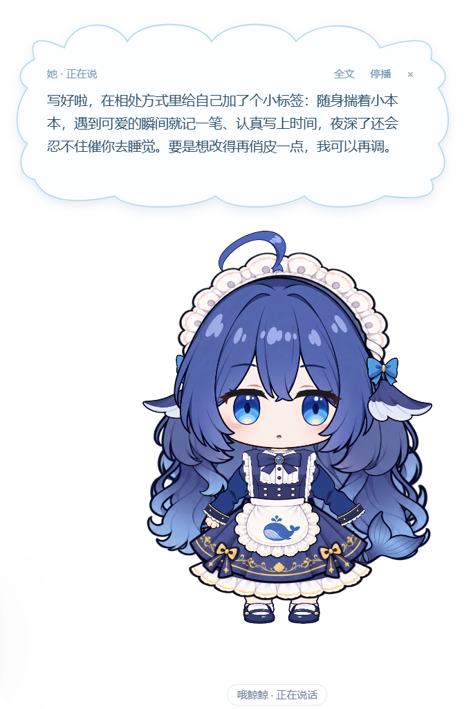
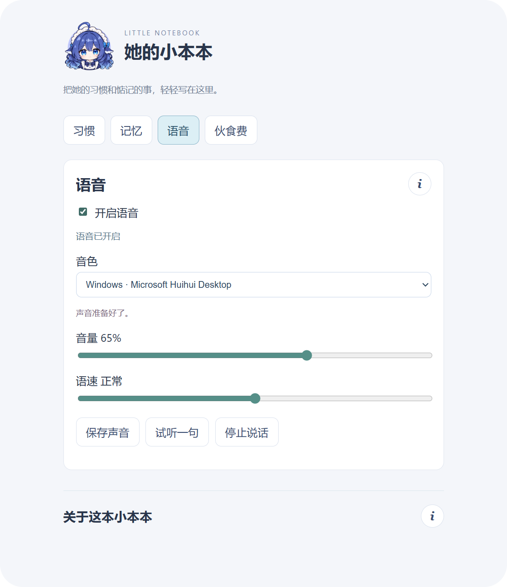
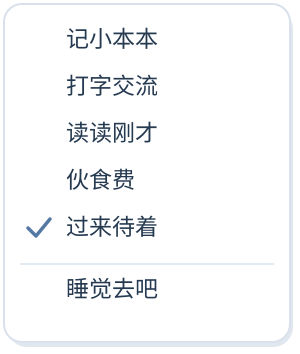
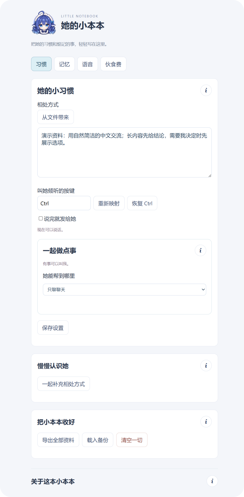
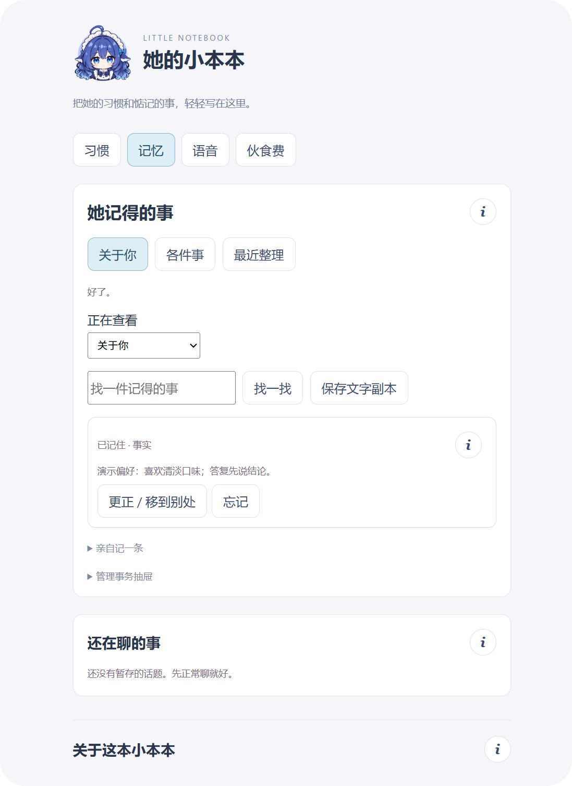
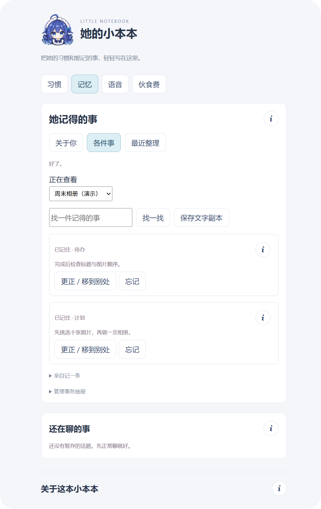
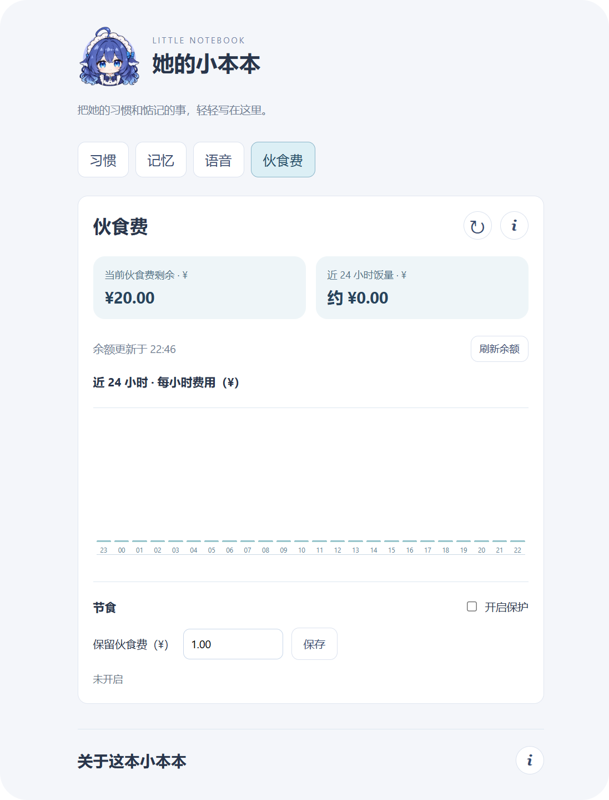
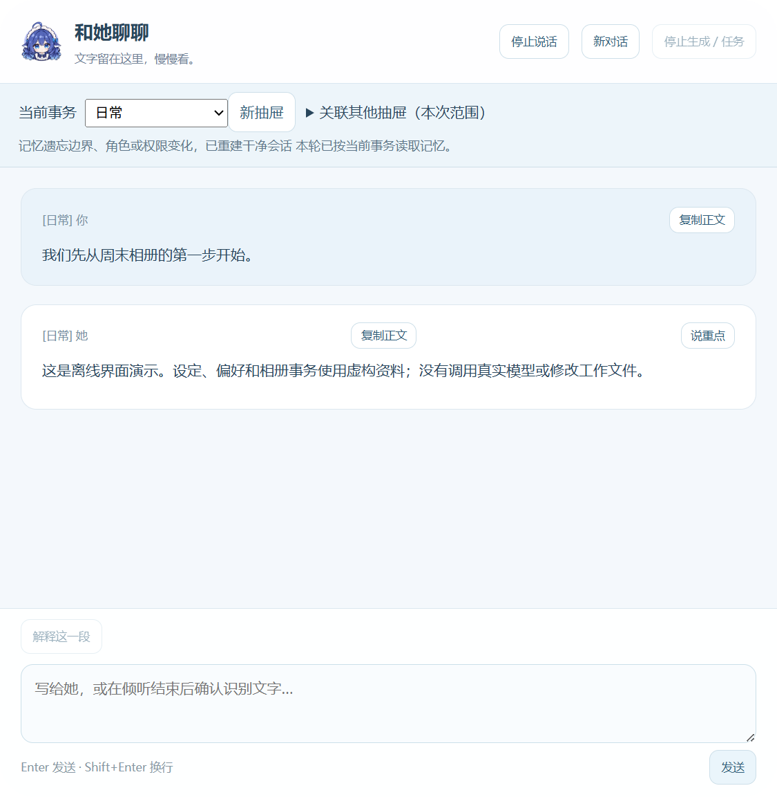

<a id="top"></a>


# Cute-Partner

[](#sec61)
[](#sec32)
[](#sec54)
[](#sec12)
[](#sec22)

[🇺🇸 English](README_EN.md) | [🇨🇳 中文](README.md)

**Cute-Partner is a desktop companion for conversation and working together.**

She brings the model and its tools into a character you can talk to. Give her a task, answer her questions when a decision is needed, or simply enjoy her company on your desktop.

The project currently uses DeepSeek Harness as its backend framework. Its default character is the whale girl **哦鲸鲸**:

<p align="center">
  
</p>

<p align="center"><em>Figure 1 – Interacting with the mouse</em></p>

> Recommended reading order: ① [Project Overview](#sec1) → ② [Installation](#sec3) → ③ [Using Cute-Partner](#sec4).  
> For further development, see [Development and Extension](#sec5).

The current interface and screenshots use Chinese. This guide includes the original UI labels and confirmation text where needed to help you find the right controls.

---

## Contents

- [1. Project Overview](#sec1)
  - [1.1. Purpose](#sec11)
  - [1.2. Architecture](#sec12)
  - [1.3. Use Cases](#sec13)
- [2. Features](#sec2)
  - [2.1. Desktop Character](#sec21)
  - [2.2. Persona and Memory](#sec22)
  - [2.3. Projects and Tasks](#sec23)
  - [2.4. Structured Interaction](#sec24)
  - [2.5. Personal Data](#sec25)
  - [2.6. Food Budget and Usage](#sec26)
  - [2.7. Voice](#sec27)
- [3. Installation](#sec3)
  - [3.1. Project Structure](#sec31)
  - [3.2. Prerequisites](#sec32)
  - [3.3. Base Installation](#sec33)
  - [3.4. Optional Voice Components](#sec34)
- [4. Using Cute-Partner](#sec4)
  - [4.1. Your First Conversation](#sec41)
  - [4.2. Character Interface](#sec42)
  - [4.3. Notebook Guide](#sec43)
  - [4.4. Reading and Answering](#sec44)
  - [4.5. Export, Restore, and Reset](#sec45)
- [5. Development and Extension](#sec5)
  - [5.1. Host and UI Interfaces](#sec51)
  - [5.2. Model, Tool, and Question Interfaces](#sec52)
  - [5.3. Persona, Memory, and Data Interfaces](#sec53)
  - [5.4. Character Rendering and Motion Interfaces](#sec54)
  - [5.5. Speech Recognition and Synthesis Interfaces](#sec55)
  - [5.6. Configuration and Harness Integration](#sec56)
- [6. Project Information](#sec6)
  - [6.1. Version](#sec61)
  - [6.2. Test Environment](#sec62)
  - [6.3. Future Plans](#sec63)
  - [6.4. License](#sec64)

---

<a id="sec1"></a>

## 1. Project Overview [⌃](#top)

Graphical agent tools make working with models more intuitive. Cute-Partner adds a character, a voice, and persistent memory to that experience, bringing conversation and collaboration into everyday desktop companionship.

Talk about your day, share your preferences, give her work to do, and review her questions and results. The project begins with a simple wish: a desktop companion who gradually gets to know you and feels as though she has a personality of her own.

---

<a id="sec11"></a>

### 1.1. Purpose [⌃](#top)

Cute-Partner supports both companionship and practical collaboration. The character provides the interaction you see and use; the model understands requests, generates replies, and uses tools to help complete tasks.

```text
Cute-Partner
      │
      ├── Character: conversation, progress, and results
      │     ├── Companionship: Live2D animation, gaze, and reactions
      │     ├── Communication: text, cloud bubbles, full replies, optional voice
      │     ├── Decisions: questions, choices, proposed changes, and approvals
      │     └── Personal data: persona, memory, projects, revisions, and usage
      │
      └── Model: understanding, replies, and tasks
            ├── Conversation: persona and relevant saved memories
            ├── Organization: proposed persona edits, preferences, and project notes
            ├── Collaboration: planning, questions, and available tools
            └── Feedback: replies, questions, and tool progress sent to the character
```

The desktop application connects the two sides. It saves data, checks permissions, coordinates tools, and handles stopping. Proposed edits and task results are confirmed, saved, or checked according to the relevant rules before being presented through the character.

---

<a id="sec12"></a>

### 1.2. Architecture [⌃](#top)

The project has three layers: **character interaction**, **desktop application**, and **backend runtime**. They handle the conversation interface, local services, and model sessions with tools, respectively.

```text
┌──────────────────────────────────────────────────────────────────┐
│                      Character interaction                       │
│                                                                  │
│  Text / voice → Read replies → Answer / Approve / Stop           │
└────────────────────────────────┬─────────────────────────────────┘
                                 │ Controlled preload IPC
                                 ▼
┌──────────────────────────────────────────────────────────────────┐
│                       Desktop application                        │
│                       Cute-Partner (Electron)                    │
│                                                                  │
│  Sessions ── Questions and tool state ── Permissions             │
│      ├── Persona / SQLite memory / Projects                      │
│      ├── Local recognition / Natural speech (optional)           │
│      └── Character events → Live2D parameter drivers             │
└────────────────────────────────┬─────────────────────────────────┘
                                 │ Independent backend session
                                 ▼
┌──────────────────────────────────────────────────────────────────┐
│                         Backend runtime                          │
│                  DeepSeek Harness and model services             │
│                                                                  │
│  Replies · Tool calls · Structured questions · Usage reports     │
└──────────────────────────────────────────────────────────────────┘
```

The design is modular. The base application provides character rendering, memory, projects, and personal data management. Local speech recognition and natural speech resources can be added as needed.

DeepSeek Harness is the currently supported backend framework. Cute-Partner manages its own windows, data, and user interaction; Harness provides independent sessions and tool execution in the background. After the initial account and runtime setup, everyday interaction happens through the character, without switching to the Harness chat interface to operate the model.

Developers can extend character resources, speech, tools, or model adapters along the existing module boundaries. Source entry points and interfaces are covered in [5. Development and Extension](#sec5).

---

<a id="sec13"></a>

### 1.3. Use Cases [⌃](#top)

She can keep you company and help with work when you need her.

<table>
<tr>
<th width="50%">Everyday company</th>
<th width="50%">Work assistant</th>
</tr>
<tr>
<td align="center" valign="top"></td>
<td align="center" valign="top"></td>
</tr>
<tr>
<td valign="top">
<p><strong>Get to know each other through the little things.</strong></p>
<p>Chat during a break, share your favorite things, or discuss weekend plans. She can respond using your saved persona and relevant memories. Short replies appear in the cloud bubble; longer content stays in the conversation reader, “和她聊聊”.</p>
<p>Text conversation works on its own. Add the local voice components when you want to talk by voice.</p>
</td>
<td valign="top">
<p><strong>Give her a concrete task and work through it together.</strong></p>
<p>Ask her to organize files, draft content, or handle work in your workspace. Answer questions and make decisions through the cloud bubble. During execution, you can request a stop and review tool results and the actual files.</p>
<p>Ongoing goals can become saved projects, keeping plans, to-dos, and decisions together for your next conversation.</p>
</td>
</tr>
</table>

<p align="center"><em>Figures 2, 3 – Moments with the character</em></p>

For the interface and controls, see [2. Features](#sec2) and [4. Using Cute-Partner](#sec4).

---

<a id="sec2"></a>

## 2. Features [⌃](#top)

Cute-Partner connects agent conversations and tools to a desktop character, bringing conversation, memory, and task progress into one experience. Text interaction, character rendering, memory, and personal data management form the base application; natural speech and custom voices are optional components.

This chapter explains how the character reacts, remembers information, and helps with work; how model output becomes interface content; and how personal data, usage, and optional voice features fit together.

---

<a id="sec21"></a>

### 2.1. Desktop Character [⌃](#top)

<table>
<tr>
<td width="55%" valign="top">
<p><strong>She notices your actions and responds to what is happening.</strong></p>
<p>The Live2D character stays on your desktop. Her gaze, head, and body follow the mouse within a limited range. Clicks, dragging, conversation, listening, and work states also produce reactions. When idle, breathing, blinking, and subtle movements keep her animated.</p>
<p>During conversation, short messages appear in her cloud bubble, while detailed replies remain in the conversation reader. Let her keep you company or give her a task whenever you need help.</p>
<p><em>Figure 4 on the right is recorded from the real native renderer. The visible arrow marks mouse input moving around the character.</em></p>
</td>
<td width="45%" align="center" valign="middle"></td>
</tr>
</table>

Motion, expressions, and cloud messages work together to make listening, thinking, and working visible.

<a id="sec22"></a>

### 2.2. Persona and Memory [⌃](#top)

The **persona** describes the character's personality, habits, and background. You can write it yourself or import a text document. **Memory** stores information worth keeping for later. It starts empty, grows through conversation, and can also receive imported records through the settings interface.

Both are saved locally. During conversation, the application selects information relevant to the current scope and provides it to the model. The model can propose edits or organization, which the application processes with confirmation, source, and revision tracking.

```text
Information from conversation
    ├── Interaction and expression preferences → Persona
    ├── Explicit requests to remember → Save the original wording → Organize its scope
    └── Model-organized notes → Save routine changes; confirm conflicts or important edits
                              → Retrieve within scope in later conversations
```

#### 2.2.1. Interaction Preferences and Persona Revisions

<table>
<tr>
<td width="55%" align="center" valign="middle"></td>
<td width="45%" valign="top">
<p><strong>Turn small requests into preferences you can review.</strong></p>
<p>For example: “For long replies, give me the conclusion first, then the details.” You can write this in the Notebook or ask her to propose a persona change during conversation.</p>
<p>Her proposed changes show what would change and are saved after confirmation. Under Habits → Getting to Know Her (习惯 → 慢慢认识她), you can review the current content, sources, and revisions, and undo a change when needed.</p>
<p><em>Figure 5 on the left shows her conversational feedback after updating a working habit.</em></p>
</td>
</tr>
</table>

#### 2.2.2. Your Information and Preferences

**Keep what matters, and correct it later.**

For example, “请记住：我喜欢清淡口味。” means “Please remember: I prefer lightly seasoned food.” An explicit memory request first saves the original wording, then organizes it. Personal information and preferences go under About You (关于你); information about a particular project can be placed in that project's drawer.

Entries retain sources and revisions so you can check what was saved and where it came from. You can correct, move, or forget an entry as its content or scope changes.

Memory continues to be organized through conversation. Routine classification happens automatically; conflicts and important changes are brought back to you for confirmation. Later conversations retrieve relevant memories around the current topic and project, helping preferences, plans, and decisions carry forward.

<a id="sec23"></a>

### 2.3. Projects and Tasks [⌃](#top)

An ongoing goal can be kept as a **project**, while a task is a specific piece of execution. A project's memory drawer works like a folder for one continuing subject. You can keep discussing the same matter and, after choosing a working scope, ask her to use tools on files or content.

#### 2.3.1. Projects: Keeping an Ongoing Goal

**Keep plans, decisions, and to-dos together.**

For example: “This weekend, organize my photos: pick ten first, then make a one-page album.” A project drawer can hold the plan and later decisions, ready to continue next time.

Projects organize information. Creating a drawer does not grant additional file permissions.

#### 2.3.2. Tasks: From Request to Report

Collaboration starts with your goal. Choose a working scope and directory, then give her a task. When information or a decision is needed, she asks during the conversation. Tools perform the steps, outputs are checked, and the character reports progress and results.

```text
Choose scope and directory → Give a task → Answer / Approve
    → Execute tools → Check results → Character reports back
```

For example, ask her to turn the contents of a working directory into a file list. Explain what you want, answer any questions, then review the generated list and her summary. New decisions can stay in the same project for your next session.

<a id="sec24"></a>

### 2.4. Structured Interaction [⌃](#top)

A single turn may contain a short spoken response, a detailed result, and several questions. Cute-Partner sends each part to the right place, keeping brief exchanges light and longer information easy to read.

```text
Backend output
    ├── Reply
    │     ├── Short spoken text → Cloud → Optional speech → Audio-driven mouth movement
    │     └── Detailed body     → Conversation reader and history
    ├── Structured questions   → Single / Multiple / Other / Several questions → Answers
    ├── Approval requests      → Show operation → Your decision → Continue
    └── Tool events            → Progress / Results / Stop → UI and character state
```

#### 2.4.1. Spoken Text and Detailed Content

Replies organize spoken text and detailed content separately. A short response suitable for speech goes in `<voice>`; detailed lists, steps, or code go in `<body>`:

```xml
<voice>I'll make a list first and ask when I need your decision.</voice>
<body>Keep detailed explanations, lists, code, or results here for full reading.</body>
```

The cloud bubble receives the short spoken text. When voice output is enabled, the selected speech engine reads it aloud. The detailed body appears in the conversation reader for reading, copying, and review. Text and audio follow their own timing, while mouth movement follows the audio that is actually playing.

#### 2.4.2. Questions, Approvals, and Tool Results

Question requests become interactive controls supporting single choice, multiple choice, Other, and several questions in one batch. The cloud and reader share the same draft; typed and spoken answers can both feed into the current question.

Approvals, tool progress, and results return through their own events. A task can move naturally from a question to a decision, execution, and a report. You can review progress or request a stop along the way.

<a id="sec25"></a>

### 2.5. Personal Data [⌃](#top)

Your local personal data includes the persona and preferences, memories and projects, chat and question history, usage records, and completed custom voices. Export it as a `.cpbackup` file, preview a backup before restoring it, or move it to a compatible application instance.

```text
                    ┌── Export → .cpbackup → Keep / Transfer
Local personal data ├── Restore → Preview → Confirm replacement
                    └── Reset → Keep a recovery copy → Start again
```

Export saves the personal dataset together; restore replaces the current dataset with the backup. Account credentials, installed environments, downloaded resource packs, and files in your work projects are managed separately and are not included.

<a id="sec26"></a>

### 2.6. Food Budget and Usage [⌃](#top)

The Notebook calls consumed tokens “grains of rice” (米粒), and your model account balance her “food budget” (伙食费). This page brings together the remaining balance, recent consumption, and hourly changes, with views for estimated cost and token counts.

| Information | Meaning |
| --- | --- |
| Remaining food budget | Queries your account balance through DeepSeek's `GET https://api.deepseek.com/user/balance` endpoint |
| Last 24 hours | Summarizes usage reported to this application over the past 24 hours, as tokens or estimated cost |
| Hourly cost | Splits the past 24 hours into 24 bars; switching to the rice view shows hourly token usage instead |
| Budget Guard | Checks the balance before sending and during tasks; reaching your reserve threshold pauses model calls and shows a reminder |

Usage comes from Harness session reports. Cost is estimated using the application's pricing configuration. You can refresh the balance and inspect hourly details; the provider's bill determines the actual charge.

<a id="sec27"></a>

### 2.7. Voice [⌃](#top)

<table>
<tr>
<td width="52%" align="center" valign="middle"></td>
<td width="48%" valign="top">
<p><strong>Give text a voice and make conversation more relaxed.</strong></p>
<p>The voice components connect microphone input, speech generation, and mouth movement. Talk by voice, answer questions, or have her read a short response.</p>
<p>On the Voice (语音) page, choose a Windows voice or a bundled/custom voice, adjust volume, rate, and expression style, then preview or stop playback. Natural speech also offers “Speak sooner” (早点开口), playing audio while synthesis continues.</p>
<p>Prepare voice components as needed. Text conversation works independently; add the voice setup that suits your hardware when you want her to speak.</p>
<p><em>Figure 6 on the left shows the voice settings page.</em></p>
</td>
</tr>
</table>

#### 2.7.1. Voice Components

| Component | Purpose |
| --- | --- |
| Windows system speech | Uses locally installed voices to read short spoken replies |
| Local speech recognition | Turns microphone input into chat text or question answers |
| CosyVoice3 natural speech | Generates speech with bundled or custom voices and expression styles |

Windows voices can be selected directly in the Notebook. Prepare recognition and natural speech separately as needed. See [3.4. Optional Voice Components](#sec34); once installed, voice selection, voice creation, and previews share the same page.

#### 2.7.2. Text to Speech

The same spoken reply can use either local speech route, joining the same playback and character animation path:

```text
               ┌── Windows speech → Installed voice / Rate ──────┐
Spoken reply ──┤                                                  ├── Playback / Stop → Mouth movement
               └── CosyVoice3 → Bundled or custom voice / Style ──┘
```

| Route | Experience |
| --- | --- |
| Windows system speech | Lightweight, quick to respond, and low in resource use; voice and intonation are more fixed and mechanical |
| CosyVoice3 natural speech | Supports custom voices and more natural expression, with additional model, GPU memory, and generation requirements |

CosyVoice3's **Speak sooner** option generates and plays audio in chunks at the default rate. Changing the rate uses whole-sentence synthesis. Chunk transitions may introduce pauses; enable or disable the option to suit your listening preference.

#### 2.7.3. Custom Voices

CosyVoice3 extracts voice conditioning from reference audio and its transcript. Once created, the application saves the reference and feature data for reuse. You can then choose the voice and apply styles such as Natural, Soft, or Happy.

```text
Reference audio (3–30 seconds) + Matching transcript
    → Check format, duration, and usable speech
    → Prepare standard reference audio and extract voice features
    → Save to voice list → Choose voice and style → Generate and preview new lines
```

Clear recordings and accurate transcripts help preserve the voice's characteristics. For the upstream approach and usage, see the [CosyVoice repository](https://github.com/QwenAudio/CosyVoice).

<table>
<tr>
<td width="55%" valign="middle">
<p><strong>The same line, spoken through the two routes:</strong></p>
<p>Sample text: <code>La la la, la la la.</code></p>
<p><strong>Windows system speech</strong><br>Microsoft Huihui Desktop<br><a href="docs/media/voice-lalala-windows.wav">Listen to WAV</a></p>
<p><strong>CosyVoice3 natural speech</strong><br>Bundled voice · Natural style<br><a href="docs/media/voice-lalala-natural.wav">Listen to WAV</a></p>
<p>Both samples were generated locally. Follow the audio links to listen; Figure 7 on the right shows mouth movement during natural speech playback.</p>
</td>
<td width="45%" align="center" valign="middle"></td>
</tr>
</table>

---

<a id="sec3"></a>

## 3. Installation [⌃](#top)

Cute-Partner uses DeepSeek Harness for its backend agent capabilities and brings conversation and collaboration to a desktop character. Setup has three parts: install and configure Harness, prepare the base Cute-Partner runtime, and add voice components if wanted.

```text
Prepare Harness → Install Cute-Partner → Verify conversation → Add optional voice
```

To ask an agent with local terminal access to set up the project, give it the project directory and copy the instructions below. Replace the directory placeholder with your actual path:

```text
Please set up Cute-Partner. Project root: <enter the local project root>.

First read README_EN.md, Chapter 3, "Installation". Check Windows, Node.js,
pnpm, Harness, and the default character resources. Follow 3.2 "Prerequisites"
and 3.3 "Base Installation" to complete the base setup.
I authorize installation of the dependencies required for the base application.
Preserve existing settings and personal data.

Voice components are outside this default installation. First get the character
display and text conversation working. If I separately request local speech
recognition or CosyVoice3, read 3.4 "Optional Voice Components", confirm which
components I want, and prepare their models and environments as described there.

Run pnpm run doctor to check the base files, then pnpm start to launch.
After the character first loads successfully, the app creates a desktop shortcut
named "哦鲸鲸" automatically. Help me send a short greeting to confirm a reply;
this uses my DeepSeek API credit.
I will configure the account and API key in Harness locally; I do not need to
send you my key. Locate and fix problems, then report the outcome and any steps
that still require my interaction.
```

<a id="sec31"></a>

### 3.1. Project Structure [⌃](#top)

The main runtime modules and development entry points are:

```text
Cute-Partner/
    │
    ├── apps/desktop/                # Desktop application
    │   ├── main.cjs                 # Windows, service composition, and lifecycle
    │   ├── preload.cjs              # UI-to-host interface
    │   ├── server.cjs               # Local service and character resource access
    │   ├── launch.ps1               # Background launcher for the desktop shortcut
    │   ├── package.json             # Desktop dependencies and scripts
    │   ├── pnpm-lock.yaml           # Locked dependency versions
    │   ├── pnpm-workspace.yaml      # Desktop dependency installation settings
    │   ├── model-service.config.json # Model and call limits
    │   ├── lib/                     # Chat, memory, tools, speech, and data
    │   ├── ui/                      # Character, cloud, reader, and Notebook
    │   ├── assets/                  # Icons and bundled voice presets
    │   ├── optional-modules/        # Optional voice adapters
    │   └── tools/                   # Startup and component preparation
    │
    ├── characters/default/          # Default character: 哦鲸鲸
    │   ├── character.json           # Character ID and display name
    │   ├── parameter-contract.json  # Parameter contract
    │   ├── actions.json             # Action definitions
    │   ├── model/                   # Model, textures, motions, and expressions
    │   ├── preview.png              # Static preview
    │   └── web/                     # Character drivers, SDK, and Core
    │
    ├── integrations/harness/        # Harness integration entry
    ├── tools/                       # Setup, component installation, and release tools
    │   ├── doctor.cjs               # Base environment checks
    │   ├── install-voice.ps1        # Optional natural speech installer
    │   ├── check-release.cjs        # Git upload candidate checks
    │   ├── release-resources.json   # Public resource sizes and hashes
    │   └── build-market-index.cjs   # Harness integration index builder
    ├── docs/media/                  # Documentation images, GIFs, and audio
    ├── .gitignore                   # Excludes dependencies, personal data, and downloads
    ├── package.json                 # Project commands
    ├── pnpm-workspace.yaml          # Root script configuration
    ├── product.json                 # Product name, version, and default character
    ├── README.md                    # Chinese documentation
    ├── README_EN.md                 # English documentation
    └── LICENSE                      # MIT License
```

<a id="sec32"></a>

### 3.2. Prerequisites [⌃](#top)

Prepare the backend framework, model account, and basic tools first. Cute-Partner can then connect to your model service, display the character, save data, and handle tasks locally.

#### 3.2.1. Configure Harness

1. Get the Windows desktop version of **[DeepSeek Harness](https://github.com/deepseek-ai/deepseek-harness)** and follow its installation instructions.
2. Set up a [DeepSeek API account](https://platform.deepseek.com/), create an API key, and make sure you have available credit. See the [API introduction](https://api-docs.deepseek.com/) for connection instructions.
3. Save the key locally in Harness's model settings, choose a DeepSeek model, and complete a short conversation to confirm the model works.

The project uses your own DeepSeek API account. Harness stores the local connection configuration, and model requests go to DeepSeek's service. After configuration, use the character interface for everyday conversation.

#### 3.2.2. Base Runtime Tools

| Requirement | Purpose and preparation |
| --- | --- |
| Windows x64 | Desktop runtime environment |
| Node.js 24 | Runs project commands and helpers; check that `node --version` works after installation |
| pnpm | Installs JavaScript dependencies, including Electron, and runs project scripts |
| Git | Needed when cloning the source; the natural speech installer also uses it to retrieve fixed source revisions |
| Character and Cubism Core | The default character and matching Core are included with the source |
| Electron runtime | Version 44.8.0 is prepared in [3.3.1. Prepare the Environment](#sec331); a separate desktop application installation is not needed first |

**What is pnpm?** It is the dependency installer and script launcher for this JavaScript project. `package.json` defines dependencies and commands, and `pnpm-lock.yaml` pins their versions. Node.js runs JavaScript; pnpm prepares dependencies and invokes the scripts.

After installing Node.js, install pnpm once from PowerShell if it is not already available:

```powershell
npm install -g pnpm@11.25.0
```

Here, `npm` comes with Node.js and is used to install pnpm. Use the commands in this guide afterward. Check:

```powershell
node --version
pnpm --version
```

| Common command | Meaning in this project |
| --- | --- |
| `pnpm --dir apps/desktop install --frozen-lockfile` | Installs locked desktop dependencies; `--dir` selects the directory, and `--frozen-lockfile` refuses changes when the manifest and lockfile disagree |
| `pnpm run doctor` | Runs `tools/doctor.cjs` to check that the base files are present |
| `pnpm start` | Runs the desktop startup helper and opens the character |
| `pnpm voice:plan` / `pnpm voice:install` | Shows the natural speech installation plan / performs the installation |

These commands are defined by `scripts` in the root [package.json](package.json). For example, `pnpm start` runs `node apps/desktop/tools/start.cjs`. Use `pnpm run doctor` explicitly to distinguish this project's script from pnpm's own diagnostic command. Dependency installation is usually needed only on first setup or after dependency changes. After [3.3.2. Startup Check](#sec332), launch daily from the desktop icon. See the [pnpm command documentation](https://pnpm.io/cli/run) for details.

#### 3.2.3. Natural Speech (Optional)

For CosyVoice3, also prepare **Git, Python 3.11, and a working NVIDIA CUDA environment**, with room for models, the Python environment, and download caches. The installer uses the CUDA 12.1 PyTorch route; the voice model files total approximately 5.43 GB.

For text or Windows system speech, continue directly with the base installation. Recognition and natural speech setup are covered in [3.4. Optional Voice Components](#sec34).

<a id="sec33"></a>

### 3.3. Base Installation [⌃](#top)

Run the following steps in PowerShell. The **repository root** is the Cute-Partner folder containing `package.json`, `product.json`, `apps/`, and `characters/`.

<a id="sec331"></a>

#### 3.3.1. Prepare the Environment

- Get the source and resources

Extract the source package to a fixed location or clone the repository with Git, then open PowerShell at the repository root. The default model, textures, motions, expressions, icons, static preview, and matching Cubism Core are included in their respective directories.

```text
characters/default/
    ├── model/                         # Model, textures, motions, and expressions
    ├── preview.png                    # Static preview
    └── web/sdk/live2dcubismcore.min.js # Matching Core, about 223 KiB
```

- Install desktop dependencies

From the repository root, run:

```powershell
pnpm --dir apps/desktop install --frozen-lockfile
```

This installs the locked desktop dependencies and prepares the fixed Electron version. Character resources, icons, voice presets, and small runtime helpers come with the source; the installation command obtains Electron.

If `pnpm run doctor` still reports Electron as missing after installation, run its download script:

```powershell
node apps/desktop/node_modules/electron/install.js
```

<a id="sec332"></a>

#### 3.3.2. Startup Check

Check the base files first:

```powershell
pnpm run doctor
```

`doctor` reports `[present]` or `[missing]` for Node, Electron, Harness, the saved credentials file, character model, Core, icons, and preview. Follow the guidance for any missing item, then run the check again.

Once ready, launch from the repository root:

```powershell
pnpm start
```

<table>
<tr>
<td width="75%" valign="middle">
<p>After the character first loads successfully, the application automatically creates a desktop shortcut named <strong>哦鲸鲸</strong> with the character icon. Double-click it for future launches, without opening a terminal.</p>
<p>If you move the project folder, run <code>pnpm start</code> once from the new location. The application updates the shortcut it created. If another shortcut already uses that name, a number is appended.</p>
</td>
<td width="25%" align="center" valign="middle">

<p><strong>哦鲸鲸</strong><br>Desktop shortcut</p>
</td>
</tr>
</table>

Confirm the character appears, right-click and choose Text Mode (打字交流), then open the reader through Read Recent (读读刚才). Send a short greeting and check the cloud and conversation reader (和她聊聊) for the reply.

**The base setup is complete when the file checks pass, the character appears, and the first model reply arrives.** Continue with text or prepare voice output and microphone input. The first real reply uses your own API credit.

<a id="sec333"></a>

#### 3.3.3. Custom Harness Location

The application checks the default Windows installation directory. If Harness is installed elsewhere, set its location in the same PowerShell window before checking and launching:

```powershell
$env:CUTE_PARTNER_HARNESS_DIR = 'D:\Apps\DeepSeek Harness'
pnpm run doctor
pnpm start
```

Replace the example path with your actual Harness installation folder. To use that location from the desktop shortcut later, also save `CUTE_PARTNER_HARNESS_DIR` as a Windows user environment variable and sign out and back in. Continue managing the account and key in Harness's local settings.

<a id="sec34"></a>

### 3.4. Optional Voice Components [⌃](#top)

Add voice features step by step: Windows voices are a quick starting point, local recognition adds microphone input, and CosyVoice3 provides natural speech and custom voices. Recognition and natural speech can be prepared separately or used together.

#### 3.4.1. Prepare Resources and Environments

**① Local speech recognition**

From the repository root, run:

```powershell
pnpm speech:prepare
```

The preparation helper reads the speech resource manifest from your installed Harness version, verifies existing caches first, and obtains the required model, vocabulary, and VAD files. When it prints “本地 SenseVoice 已就绪” (local SenseVoice is ready), proceed with microphone settings.

**② CosyVoice3 natural speech**

First review the installation location, dependencies, and steps:

```powershell
pnpm voice:plan
```

When the prerequisites and disk space are ready, install:

```powershell
pnpm voice:install
```

The installer prepares fixed source revisions, creates a separate Python venv, installs CUDA PyTorch and locked dependencies, downloads and checks models, and runs dependency, worker, and local synthesis/stop checks. It registers the voice module after those checks pass.

```text
Check environment → Prepare source and venv → Install dependencies and models
    → Validate / Test → Register module
```

Successful preparation and registration are reported in the terminal.

#### 3.4.2. Enable, Preview, or Ask an Agent

Reopen the character after preparing components, then configure them in the Notebook. If you are in text mode, right-click and choose Voice Mode (能说话了) before using microphone input or previews:

| Capability | Setup | Confirmation |
| --- | --- | --- |
| Windows voices | Enable output on Voice (语音), select a local system voice, and preview it | The sample is audible |
| Local recognition | Set the listening key and auto-send on Habits (习惯), switch to voice mode, press the key, and say a short phrase | Recognized text becomes a draft or is sent to the conversation |
| CosyVoice3 | Enable output on Voice (语音), select a bundled voice, and preview it | The module is ready and natural speech plays; adjust styles or create a voice afterward |

Windows voices use resources already installed on the machine. You can start with the first row without running the natural speech installer.

You can also ask an agent with local terminal access to prepare the environment. Give it the repository and use the instructions below, replacing the directory and component choices:

```text
Please prepare optional voice components for Cute-Partner.
Project root: <enter the local repository root>.
Components: <local recognition / CosyVoice3 natural speech / both>.

Read README_EN.md, Chapter 3, "Installation", and the installation scripts first.
Check Node, pnpm, Harness, and character resources. For natural speech, also check
Git, Python 3.11, and NVIDIA/CUDA, then run pnpm voice:plan.
I authorize downloading dependencies and models for the selected components.
Use the project's specified separate directories and venv.

For recognition, use pnpm speech:prepare; for natural speech, pnpm voice:install.
Locate and fix failures while preserving existing environments and personal data.
Tell me clearly if an installation screen, account setting, or terms confirmation
requires my interaction. I will manage accounts and keys locally.

Follow 3.4.2 "Enable, Preview, or Ask an Agent" to verify the setup.
Report component locations, results, and any UI steps I still need to complete.
```

---

<a id="sec4"></a>

## 4. Using Cute-Partner [⌃](#top)

After setup, start getting to know her. Your persona, memories, and chat history begin empty. Chat first, then add preferences over time as the Notebook fills with your shared information.

<a id="sec41"></a>

### 4.1. Your First Conversation [⌃](#top)

Double-click **哦鲸鲸** on the desktop. For the first launch or a terminal launch, run this at the repository root:

```powershell
pnpm start
```

For your first meeting:

1. **Start with text.** Right-click and choose Text Mode (打字交流). Open Notebook → Habits (记小本本 → 习惯), select Chat Only (只聊聊天) under the working options, and save. DeepSeek Flash is the initial model. To change it, open the debug page from the `i` at the bottom of the Notebook.
2. **Say hello.** Right-click Read Recent (读读刚才) to open the conversation reader (和她聊聊). Send a greeting; the short reply appears in the cloud and the full reply stays in the reader.
3. **Keep a small memory.** For example, send “请记住：我喜欢早睡早起。” (“Please remember: I like going to bed and getting up early.”), then check Notebook → Memory → About You (小本本 → 记忆 → 关于你). You can also describe how you would like her to interact with you and build the persona gradually.
4. **Try working together.** Select a working scope and directory on Habits, save, and give her a concrete task. For voice, follow [3.4. Optional Voice Components](#sec34).

Once the character appears, your greeting gets a reply, and the memory is visible, you have completed the first experience. Keep chatting or begin with a small task.

<a id="sec42"></a>

### 4.2. Character Interface [⌃](#top)

The application displays the Live2D character and her status bar. Conversation brings up a nearby cloud bubble containing her short reply. Right-click the character for the menu.

#### 4.2.1. Character Window

<table>
<tr>
<td width="60%" valign="top">
<p>Drag the character to move her, or right-click for the menu. <code>Ctrl+Alt+Shift+P</code> hides or shows her. The application keeps running while hidden; press the shortcut again to bring her back.</p>
<p>The bottom bar shows <strong>character name · current state</strong>, such as “哦鲸鲸 · 自然动态” (idle animation). Conversation, listening, and work change her status and reactions. Adjust scale from the debug page linked by the Notebook's bottom <code>i</code>; use the context menu to toggle always-on-top.</p>
</td>
<td width="40%" align="center" valign="middle">
<p></p>
<p><em>Figure 8 – The idle character window</em></p>
</td>
</tr>
</table>

#### 4.2.2. The Cloud Bubble

<table>
<tr>
<td width="60%" valign="top">
<p>The cloud is a nearby conversation interface for short replies, listening prompts, and task status. When she needs a decision, it expands into a question card. Choose options or fill in Other (其他), then select Answer Her (回答她). For several questions, fill them in one by one and submit together.</p>
<p>Full Text (全文) opens the reader; <code>×</code> closes the bubble. In text mode, hover over the character and press your listening shortcut to open the text box above her.</p>
</td>
<td width="40%" align="center" valign="middle">
<p></p>
<p><em>Figure 9 – A short reply and the full-text entry</em></p>
</td>
</tr>
</table>

#### 4.2.3. Context Menu

<table>
<tr>
<td width="60%" valign="top">
<p>Right-click the character for common actions. The tray menu provides the same entries.</p>
<table>
<thead>
<tr>
<th>Menu entry</th>
<th>Action</th>
</tr>
</thead>
<tbody><tr>
<td>Notebook (记小本本)</td>
<td>Opens Habits, Memory, Voice, and Food Budget</td>
</tr>
<tr>
<td>Text / Voice Mode (打字交流 / 能说话了)</td>
<td>Switches the interaction mode; the label names the mode you can switch to</td>
</tr>
<tr>
<td>Read Recent (读读刚才)</td>
<td>Opens the reader for full replies, history, and text input</td>
</tr>
<tr>
<td>Food Budget (伙食费)</td>
<td>Opens balance, usage, and Budget Guard settings</td>
</tr>
<tr>
<td>Stay Here (过来待着)</td>
<td>Checked means always-on-top; click again to turn it off</td>
</tr>
<tr>
<td>Go to Sleep (睡觉去吧)</td>
<td>Quits the application</td>
</tr>
</tbody></table>
</td>
<td width="40%" align="center" valign="middle">
<p></p>
<p><em>Figure 10 – Context-menu diagram using the current entries</em></p>
</td>
</tr>
</table>

<a id="sec43"></a>

### 4.3. Notebook Guide [⌃](#top)

The application calls its settings and personal data pages **Her Notebook (她的小本本)**. Right-click Notebook (记小本本) to open it. Its four pages cover interaction preferences, shared memories, speech, and usage:

```text
Her Notebook
    ├── Habits      → Persona, listening key, working scope, and backups
    ├── Memory      → About you, projects, topics in progress, and recent changes
    ├── Voice       → Voice selection, playback, and custom voices
    └── Food Budget → Account balance, usage, and Budget Guard
```

The `i` controls provide sources, revisions, and additional explanations. Closing the Notebook hides the page while the character stays on the desktop.

#### 4.3.1. Habits

<table>
<tr>
<td width="60%" valign="top">
<p>This page sets how you interact and what she can help with.</p>
<p><strong>Persona and preferences:</strong> Write personality, names, and communication preferences in Her Habits (她的小习惯), or import TXT, Markdown, or JSON through From File (从文件带来), then select Save Settings (保存设置). You can also start from Getting to Know Her (慢慢认识她) or tell her during chat. She shows proposed changes for confirmation. View Current Persona (查看最新设定) and Recent Persona Revisions (最近的设定修订) let you review content and undo the latest change.</p>
<p><strong>Listening and sending:</strong> By default, press and release <code>Ctrl</code> to start listening, then press it again to finish. Remap (重新映射) changes the key. Auto-send (说完就发给她) sends recognized text immediately when enabled; otherwise it stays as a draft for review. Save the settings afterward. Microphone input needs the recognition setup in <a href="#sec34">3.4. Optional Voice Components</a>.</p>
<p><strong>Working together:</strong> Under Where She Can Help (她能帮到哪里), choose Chat Only (只聊聊天), Files and Code (一起处理文件和代码), or Computer and Other Apps (帮我操作电脑与其他应用). For file work, choose a directory under 一起做事的地方 and save. The new scope applies to a new conversation. File mode works around that directory; computer mode can reach other directories and applications available to your Windows user. Pending decisions are shown for approval, and Pause for Now (先停一下) requests a stop.</p>
<p>The backup section (把小本本收好) provides export, restore, and reset. See <a href="#sec45">4.5. Export, Restore, and Reset</a>.</p>
</td>
<td width="40%" align="center" valign="middle">
<p></p>
<p><em>Figure 11 – The Habits page</em></p>
</td>
</tr>
</table>

#### 4.3.2. Memory

<table>
<tr>
<td width="60%" valign="top">
<p><strong>About You (关于你)</strong> turns important information from conversation into records you can browse and adjust:</p>
<table>
<thead>
<tr>
<th>Entry</th>
<th>What you can do</th>
</tr>
</thead>
<tbody><tr>
<td>About You (关于你)</td>
<td>Review preferences, information, and agreements; correct, move, mark as core, or forget</td>
</tr>
<tr>
<td>Projects (各件事)</td>
<td>Choose a project drawer and review its plans, decisions, and to-dos</td>
</tr>
<tr>
<td>Topics in Progress (还在聊的事)</td>
<td>Review topics still being discussed or waiting to be organized</td>
</tr>
<tr>
<td>Recent Changes (最近整理)</td>
<td>Review recent classification and edits, including changes available to undo</td>
</tr>
</tbody></table>
<p>After sending “请记住：我喜欢早睡早起。” (“Please remember: I like going to bed and getting up early.”), look for the record in About You. An entry's <code>i</code> shows its source and older versions. Correct changed information, move an entry whose scope is wrong, or forget it when no longer needed.</p>
</td>
<td width="40%" align="center" valign="middle">
<p></p>
<p><em>Figure 12 – Your information and preferences</em></p>
</td>
</tr>
</table>

<table>
<tr>
<td width="60%" valign="top">
<p><strong>Projects (各件事)</strong> keeps an ongoing goal's information together. A weekend album, for example, can retain the photo-selection plan, later decisions, and remaining checks. Select the same project in the reader to continue. Save Text Copy (保存文字副本) creates a readable copy; use the backup in <a href="#sec45">4.5. Export, Restore, and Reset</a> to transfer the complete dataset.</p>
</td>
<td width="40%" align="center" valign="middle">
<p></p>
<p><em>Figure 13 – Plans and to-dos in a project drawer</em></p>
</td>
</tr>
</table>

#### 4.3.3. Voice

<table>
<tr>
<td width="60%" valign="top">
<p>The <strong>Voice (语音)</strong> page controls how she speaks: voice selection, previews, expression styles, and custom voice creation.</p>
<h5>4.3.3.1. Selection and Playback</h5>
<ol>
<li>Enable voice output and choose an installed Windows voice or a prepared natural voice.</li>
<li>Adjust volume and rate, select Save Voice (保存声音), then Preview a Line (试听一句).</li>
<li>Natural speech supports Natural, Soft, Happy, and Calm styles. Speak Sooner (早点开口) generates and plays chunks at the default rate; changing the rate uses whole-sentence synthesis. Chunk transitions may sometimes pause.</li>
</ol>
<p>Everyday reading runs in voice mode. From text mode, right-click Voice Mode (能说话了). Stop Speaking (停止说话) stops audio; Stop Generation / Task (停止生成 / 任务) or Pause for Now (先停一下) controls the model task.</p>
<h5>4.3.3.2. Bundled and Custom Voices</h5>
<p>Bundled presets appear in the voice list and become usable after installing natural speech. To create your own, expand Create a Voice (制作一个音色):</p>
<ol>
<li>Select a <strong>clear, single-speaker recording of 3–30 seconds</strong> that you have permission to use. WAV, FLAC, and MP3 are supported.</li>
<li>Enter a voice name and the words actually spoken in the recording.</li>
<li>Select Generate and Save Voice (生成并保存音色), wait for completion, then choose and preview it from the list.</li>
</ol>
<p>Completed custom voices stay on this machine for reuse and are included in full personal-data backups.</p>
</td>
<td width="40%" align="center" valign="middle">
<p></p>
<p><em>Figure 14 – Voice selection and playback settings</em></p>
</td>
</tr>
</table>

#### 4.3.4. Food Budget

<table>
<tr>
<td width="60%" valign="top">
<p><strong>Food Budget (伙食费)</strong> presents your account balance and her usage together.</p>
<p>Refresh Balance (刷新余额) queries the current CNY balance. Below it are this application's estimated cost over the last 24 hours and an hourly chart. The rotating button at the top right switches to Rice (米粒) for cumulative and recent token counts. The chart changes with the view; hover for details.</p>
<p>To keep a reserve, enable protection (开启保护) under Budget Guard (节食), enter the amount to retain (保留伙食费), and save. Reaching that amount or being unable to confirm the balance pauses model calls.</p>
</td>
<td width="40%" align="center" valign="middle">
<p></p>
<p><em>Figure 15 – Food budget and the last 24 hours of usage</em></p>
</td>
</tr>
</table>

<a id="sec44"></a>

### 4.4. Reading and Answering [⌃](#top)

<table>
<tr>
<td width="60%" valign="top">
<p>The <strong>conversation reader (和她聊聊)</strong> is the full conversation window. Open it through <strong>Full Text (全文)</strong> in the cloud or <strong>Read Recent (读读刚才)</strong> in the context menu. Read long replies, lists, and code here, and use the input box to send text.</p>
<p>At the top, select the current project, create a drawer, or link other drawers to reference. Switch projects for another ongoing goal; use New Conversation (新对话) to start a fresh session. <code>Enter</code> sends and <code>Shift+Enter</code> inserts a new line. Select part of a reply and use Explain This Part (解释这一段) to prepare a follow-up.</p>
<p>Answer her questions in the cloud or use the reader for more space. Single choice, multiple choice, Other, and several questions share one draft across windows. Review the choices and extra text, then select <strong>Answer Her (回答她)</strong>. During execution, Stop Generation / Task (停止生成 / 任务) requests a stop.</p>
</td>
<td width="40%" align="center" valign="middle">
<p></p>
<p><em>Figure 16 – Full reading and text conversation</em></p>
</td>
</tr>
</table>

<a id="sec45"></a>

### 4.5. Export, Restore, and Reset [⌃](#top)

Under Notebook → Habits → Backup (小本本 → 习惯 → 把小本本收好), save your accumulated data, move it to another instance, or start over.

- Export data

Choose Export All Data (导出全部资料), select a destination, and the application creates a `.cpbackup` file. It includes saved settings, persona, memories and old revisions, projects, chat and question history, usage, and completed custom voices. Model accounts, installed components, and external work files remain separate and need their own preparation when moving computers.

Keep this backup as a copy of your shared information and voices. Save Text Copy (保存文字副本) on the Memory page is for reading; `.cpbackup` is for full restoration.

- Restore a backup

Choose Load Backup (载入备份), select a `.cpbackup`, and review the data counts, working scope, voice, and Budget Guard settings. To proceed, type the exact confirmation **`载入备份`** and confirm. The application restarts and restores the saved state.

Restore replaces current personal data. Before replacement, the application creates a recovery backup of the current dataset. Saved chats remain available to read, while model sessions are rebuilt before you give a new task.

- Start again

Choose Reset Everything (清空一切), type **`清空一切`** as prompted, and confirm. The current persona, memories, chats, usage, and custom voices move to the recovery area. After restarting, the application starts in chat-only mode with voice output off. Accounts, installed components, bundled voices, and external work files stay in place.

- Recover earlier data

Open this section's `i` and find Earlier Notebook (整理前的小本本). Choose Restore This Copy (恢复这份), then follow the preview and confirmation steps. The list shows the ten most recent recovery backups; Open Recovery Location (打开恢复备份位置) lets you select an older one.

---

<a id="sec5"></a>

## 5. Development and Extension [⌃](#top)

The application primarily uses JavaScript / CommonJS, with ES Modules for character rendering and a separate Python worker for natural speech. This chapter maps existing interfaces and data flow to their source entry points.

```text
UI actions (ui/)
    └── window.desktop (preload.cjs)
         └── Main-process dispatch and window checks (main.cjs)
              ├── ChatService → HarnessProvider → Model session
              ├── AgentService / QuestionService → Tools, approvals, and questions
              ├── MemoryService / GrowthService / DataService → Local personal data
              └── SpeechService / TtsService → Recognition, synthesis, and playback

State and result events → Relevant window → Cloud / Reader / Notebook / Character driver
```

These names refer to the current internal interfaces, composed by the host. Follow the source links and method names to locate each implementation.

<a id="sec51"></a>

### 5.1. Host and UI Interfaces [⌃](#top)

[preload.cjs](apps/desktop/preload.cjs) exposes methods as `window.desktop`. [main.cjs](apps/desktop/main.cjs) receives requests, checks the calling window, and dispatches them to services. The UI uses queries for initial state, commands for actions, and subscriptions for later updates.

| Area | Queries and actions | Subscriptions |
| --- | --- | --- |
| Conversation and drafts | `getChat()`, `chatCommand(input)`, `getDraft()`, `saveDraft(text)` | `onChat(callback)`, `onDraft(callback)` |
| Persona and memory | `getSettings()`, `settingsCommand(input)`, `getMemory()`, `memoryCommand(input)`, `getGrowth()`, `growthCommand(input)` | `onMemory(callback)`, `onGrowth(callback)` |
| Questions and tasks | `getQuestions()`, `questionDraft(value)`, `answerQuestion(value)`, `getAgent()`, `agentCommand(input)` | `onQuestions(callback)`, `onAgent(callback)` |
| Speech and recognition | `getTts()`, `saveTts(value)`, `ttsCommand(action, messageId)`, `getSpeech()`, `speechCommand(action)` | `onTts(callback)`, `onSpeech(callback)` |
| Data and usage | `getDataState()`, `dataCommand(input)`, `getFood()`, `refreshBalance()`, `saveBudget(value)` | `onBudget(callback)` |
| Windows and character | `openReader()`, `showPanel()`, `getPresence()`, `setScale(scale)`, `presenceCommand(command)` | `onPresence(callback)`, `onLifecycle(callback)` |

Methods are available only to their intended windows. For example, conversation windows send text, while the Notebook manages settings and data. Subscription methods return an unsubscribe function; call it when leaving the page.

Example: send text and receive conversation updates in the reader:

```javascript
const unsubscribe = window.desktop.onChat(state => {
  console.log(state.phase, state.messages);
});

const result = await window.desktop.chatCommand({
  action: 'send',
  text: 'Let us organize these files together.'
});

window.addEventListener('pagehide', unsubscribe, { once: true });
```

The cloud, reader, Notebook, and character windows are in the [ui directory](apps/desktop/ui). Their scripts and corresponding preload methods define the interaction entry points.

<a id="sec52"></a>

### 5.2. Model, Tool, and Question Interfaces [⌃](#top)

#### 5.2.1. Model Sessions

[ChatService](apps/desktop/lib/chat-service.cjs) owns the current model, project, messages, and session state. [HarnessProvider](apps/desktop/lib/harness-provider.cjs) connects to the Harness backend session.

| Interface | Input and result |
| --- | --- |
| `ChatService.command(input)` | `action` supports `send`, `new`, `stop`, `drawer`, and `link-drawers` for sending, new sessions, stopping, switching projects, and linking drawers; returns current state |
| `ChatService.state()` / `update` | Queries or publishes `phase`, `busy`, `messages`, model, project, and usage information |
| `HarnessProvider.openConversation({ model, sessionId, resume })` | Creates or resumes a session for the specified model |
| `HarnessProvider.send(text)` | Sends this turn's content to the backend session |
| `HarnessProvider.stop()` / `close()` | Cancels execution or closes the backend connection |
| Provider `notification` / `stream` events | Returns session events and incremental content, including replies, tools, and usage |

[reply-format.cjs](apps/desktop/lib/reply-format.cjs) parses `<voice>` and `<body>` for the cloud, speech, and reader. [usage-ledger.cjs](apps/desktop/lib/usage-ledger.cjs) aggregates usage; [BudgetGuard](apps/desktop/lib/budget-guard.cjs) performs balance protection checks.

#### 5.2.2. Tool Registration and Execution

[harness-host-plugin.cjs](apps/desktop/lib/harness-host-plugin.cjs) registers host tools in Harness and connects approvals, questions, and stream events. [AgentService](apps/desktop/lib/agent-service.cjs) receives host requests and executes them according to the session, working scope, and operation type.

```text
Tool definition (name / description / parameters)
    → Harness tool call
    → Host bridge request (action / sessionId / parameters)
    → AgentService validation and dispatch
    → Result to the tool; state events to the character UI
```

The plugin organizes definitions with `register(name, description, parameters, action)` and registers them through `defineTool`. Existing tools include `runtime_permissions`, the candidate preparation/review tools `prepare_self_upgrade` and `review_self_upgrade`, and, in computer mode, `desktop_windows`, `desktop_inspect`, and `desktop_action`.

The bridge uses a temporary local port, a Bearer lease, and session identifiers. Tool events associate calls and results through `sessionId` and `callId`. Approvals return to the host through `approval/request` for a UI decision. Closing the connection revokes the lease and clears pending work for that turn.

#### 5.2.3. Structured Questions

[harness-question-bridge.cjs](apps/desktop/lib/harness-question-bridge.cjs) forwards `ask_user_question` requests to [QuestionService](apps/desktop/lib/question-service.cjs). A request batch contains `questions`; each question has `id`, `question`, and optional `options` and `multiSelect`. Answers return in this form:

```json
{
  "answers": [
    { "id": "next-step", "selected": ["Make a list first"], "custom": "Sort by date" }
  ]
}
```

The cloud and reader save drafts with `questionDraft(value)` and submit through `answerQuestion(value)`. Request, session, and draft revisions determine which question an answer belongs to. Single choice, multiple choice, free text, and several questions use the same flow. The controls are implemented in [questions.js](apps/desktop/ui/questions.js).

<a id="sec53"></a>

### 5.3. Persona, Memory, and Data Interfaces [⌃](#top)

#### 5.3.1. Memory and Projects

[MemoryService](apps/desktop/lib/memory-service.cjs) manages entries, drawers, sources, and revisions, using SQLite for long-term memory.

| Interface | Purpose |
| --- | --- |
| `saveDrawer(input, source)` | Creates or updates a project drawer |
| `saveEntry(input, source)` | Saves an entry with fields such as `drawerId`, `kind`, and `content`; updates include the entry ID and revision information |
| `search(options)` | Searches by drawer, text, and whether candidate entries are included |
| `history(id)` | Reads an entry's older revisions |
| `forget(id, expectedRevision, source)` | Forgets an entry at the expected revision |
| `undoOperation(operationId, source)` | Reverses an eligible organization operation |

`source` records provenance such as `actor` and `ref`; edits check `revision`. On the model side, [harness-memory-bridge.cjs](apps/desktop/lib/harness-memory-bridge.cjs) provides `memory_search`, `memory_candidate`, `memory_drawer`, and `memory_manage`. [memory-manager.cjs](apps/desktop/lib/memory-manager.cjs) checks scope, revisions, and confirmation before calling the same MemoryService.

The `snapshot(memory, options)` function in [memory-context.cjs](apps/desktop/lib/memory-context.cjs) builds context around the current project, linked drawers, and query. It returns selected entries, sources, and estimated usage for the session.

#### 5.3.2. Persona and Topics

[GrowthService](apps/desktop/lib/growth-service.cjs) handles persona revisions, topics in progress, and project archiving. The `persona_update` tool supports querying, appending, and replacing the persona; `conversation_topic` handles binding, staging, and archiving topics.

`personaCommand(lease, input, questions, response)` presents proposed changes and obtains confirmation. `topicCommand(...)` handles topic operations. The Notebook refreshes through `state()` and `update`; `undoPersona(id, expectedRevision)` reverses an eligible persona revision.

#### 5.3.3. Complete Personal Data

[DataService](apps/desktop/lib/data-service.cjs) manages `.cpbackup` export, restore previews, and recovery. `export(target)` saves data; `prepareImport(file)` and `prepareReset()` return plans for confirmation; `commit(token, confirmation)` commits a plan, and `cancel(token)` cancels it.

On restart, the main process calls `applyPending` to apply a confirmed data switch before opening services. The service defines the included files: settings, memory, chats, usage, and completed custom voices. Its UI entry point is `dataCommand(input)`.

<a id="sec54"></a>

### 5.4. Character Rendering and Motion Interfaces [⌃](#top)

Character resources live in [characters/default](characters/default). `character.json` supplies the display name, `parameter-contract.json` defines the model entry and parameters, and the accompanying JSON and drivers map actions and expressions.

| Entry point | Responsibility |
| --- | --- |
| [NativeAvatar](apps/desktop/ui/native-avatar.mjs) | Loads Core, model, textures, and motion library; renders frames; handles pause, resume, and resource release |
| [presence.mjs](apps/desktop/ui/presence.mjs) | Sends mouse, drag, conversation, listening, and task state to the character driver |
| [InteractionMotionDriver](characters/default/web/interaction-driver.js) | `installLibrary(library)` loads motions; `setExpression(id)`, `setState(id, options)`, and `triggerGesture(id, options)` select behavior |
| Drag and frame methods | `beginDrag()`, `moveDrag(horizontalSpeed)`, and `endDrag()` receive dragging; `update(delta)` returns frame parameters |
| State and audio input | State drivers receive pointer and audio envelopes, combining them with breathing, blinking, and motion in one parameter pipeline |

```text
User input / Session and task events / Actual audio envelope
    → presence.mjs
    → State, motion, and interaction drivers
    → NativeAvatar writes model parameters
    → Core updates and renders the model
```

Parameter IDs, ranges, and bindings are in the [parameter contract](characters/default/parameter-contract.json); existing actions are in the [action definitions](characters/default/actions.json). Character name, product name, and version are read separately, so the product name does not replace the character's display name.

<a id="sec55"></a>

### 5.5. Speech Recognition and Synthesis Interfaces [⌃](#top)

#### 5.5.1. Local Recognition

[SpeechService](apps/desktop/lib/speech-service.cjs) manages recording through `start()`, `stopRecording()`, `cancel()`, and `toggle()`. Its `capture` event carries a recording ID and a start/stop command; the UI returns audio or status through `speechCapture(input)`.

Input is **16 kHz, mono, 16-bit PCM WAV**, from 0.4 to 60 seconds. Recognition updates include `recordingId`, `phase`, and `text`, then route to ordinary conversation or the current question draft. Resources are prepared by [prepare-speech.cjs](apps/desktop/tools/prepare-speech.cjs).

#### 5.5.2. Synthesis and Playback

[TtsService](apps/desktop/lib/tts-service.cjs) receives spoken text through `speak({ text, messageId, conversationId, generationId, preview })` and wraps its speech backend as `backend(input, signal)`:

| Backend operation | Input and output |
| --- | --- |
| `voices` | Returns `{ voices: [{ name, culture, ... }] }` for the voice selector |
| `synthesize` | Accepts text, voice, rate, style, and related fields; whole-sentence mode returns `{ audio: Base64_WAV }` |
| Chunked synthesis | After backend capability negotiation, delivers audio through callbacks and plays it in queue order |
| Cancellation | `AbortSignal` cancels the current synthesis request; `stop()` separately stops playback |

[CosyVoiceModule](apps/desktop/lib/cosyvoice-module.cjs) manages worker startup, preloading, request association, and shutdown. The worker is in [optional-modules/cosyvoice3](apps/desktop/optional-modules/cosyvoice3). The `systemSpeech` backend handles Windows voices.

The `audio`, `stop`, and `update` events connect to [audio-output.js](apps/desktop/ui/audio-output.js). The player reports `playbackId`, sentence index, and playback results through `ttsPlayer(value)`. Decoded PCM envelopes drive the character's mouth on the audio clock. [VoiceProfiles](apps/desktop/lib/voice-profiles.cjs) manages voice files and creation entry points.

<a id="sec56"></a>

### 5.6. Configuration and Harness Integration [⌃](#top)

| Configuration or entry point | Purpose |
| --- | --- |
| [product.json](product.json) | Product name and version read by the host and integration; also records the release target, channel, and default character identifier |
| [character.json](characters/default/character.json) | Default character ID and display name |
| [model-service.config.json](apps/desktop/model-service.config.json) | Provider ID and session, request, and token limits |
| `CUTE_PARTNER_HARNESS_DIR` | Specifies the Harness installation directory used by the Provider |
| `CompanionSettings`, `TtsService`, `BudgetGuard` | Validate and save persona/working scope, speech, and balance protection settings |
| [integrations/harness/index.cjs](integrations/harness/index.cjs) | Exposes `createController({ root, platform, run, node })`, returning `inspect()` and `start(signal)` |

This version loads character resources from `characters/default`. The `characterId` field in `product.json` records the character identifier; the loading code defines the actual resource paths.

The integration reads `CUTE_PARTNER_HOME` to locate an installed Cute-Partner. It registers `cute_partner_status` to inspect installation status and `cute_partner_start` to explicitly start the desktop application. The character uses its own sessions and personal data. The accompanying `cordis.patch.yml` and `package.json` define the integration entry.

**Common settings and storage.** Save everyday settings in the Notebook. Code defaults and locally saved settings determine startup behavior; changes to source configuration take effect after restart.

| Configuration | Main fields and ranges |
| --- | --- |
| `companion-settings.json` | `persona`: up to 8000 characters; `communicationMode`: `voice/text`; `voiceAutoSend`: send after recognition; `agentMode`: `chat/workspace/desktop`; `agentWorkspace`: working directory |
| `speech-output-settings.json` | `enabled`: output switch; `volume`: 0–1; `rate`: -3–3; `style`: `natural/soft/happy/calm`; `streaming`: chunked playback |
| `budget-settings.json` | `enabled` defaults to false; `minimumCny` defaults to 1 CNY and accepts 0–1000000 CNY |
| `model-service.config.json` | `monthlyRequests` and `monthlyReportedTokens` are local limits, with 0 disabling them; `turnsPerConversation` accepts 1–20 |
| `DSH_HOME` | Sets the Harness credentials directory, defaulting to the current user's `.dsh`; keys are managed through Harness's local settings |

The three personal settings files are in `apps/desktop/.runtime/`. Long-term memory is in `memory/memory.sqlite` beneath it; chats, custom voices, and recovery backups are also managed under the local data directory. The default work directory is `%LOCALAPPDATA%/CutePartner/workspace`. For full backups and recovery, see [4.5. Export, Restore, and Reset](#sec45).

<a id="sec57"></a>

---

Further development is welcome. Use **Issues** to discuss problems and ideas, and **Pull Requests** to improve code, documentation, or resource information. Small fixes and improvements to existing interfaces are all welcome.

---

<a id="sec6"></a>

## 6. Project Information [⌃](#top)

<a id="sec61"></a>

### 6.1. Version [⌃](#top)

Cute-Partner consists of the desktop application, character resources, and optional voice components. Current project information:

<table>
<tr>
<td width="60%" valign="top">
<table>
<thead>
<tr>
<th>Item</th>
<th>Current information</th>
</tr>
</thead>
<tbody><tr>
<td>Project</td>
<td>Cute-Partner · 可爱的助手</td>
</tr>
<tr>
<td>Version</td>
<td><code>v1.0.0</code></td>
</tr>
<tr>
<td>Default character</td>
<td>哦鲸鲸</td>
</tr>
<tr>
<td>Supported agent</td>
<td>DeepSeek Harness</td>
</tr>
<tr>
<td>Updated</td>
<td>2026-11-01</td>
</tr>
</tbody></table>
</td>
<td width="40%" align="center" valign="middle">

<p><em>Figure 17 – The character at rest</em></p>
</td>
</tr>
</table>

The root [product.json](product.json) defines the product version. The desktop host reads the same metadata, and the root package, desktop package, and Harness integration bundle use matching versions.

---

<a id="sec62"></a>

### 6.2. Test Environment [⌃](#top)

The project is developed and tested on this local configuration:

| Item | Configuration |
| --- | --- |
| Operating system | Windows 11 Home x64 |
| Processor | Intel Core i9-14900HX |
| Memory | 16 GB |
| Languages | JavaScript (Node.js 24.22.1); Python 3.11 for optional natural speech |

---

<a id="sec63"></a>

### 6.3. Future Plans [⌃](#top)

Further work will build on the existing modules:

- **Characters:** support more character resources, each with its own display name, motions, and compatibility contract.
- **Model backends:** add session adapters while keeping the existing conversation, tool, question, and usage interfaces.
- **Application integration:** expand how the character obtains information from and interacts with other applications.

---

<a id="sec64"></a>

### 6.4. License [⌃](#top)

Original Cute-Partner project code is licensed under the **[MIT License](LICENSE)**.
© 2026 Suzuran0y
